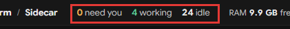
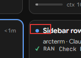
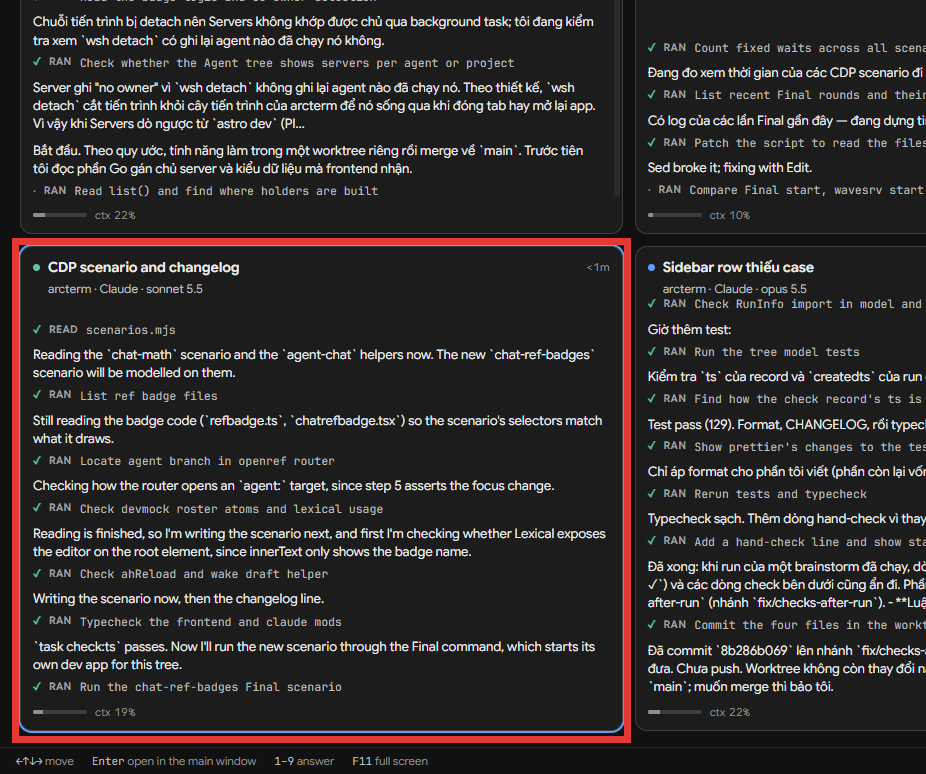
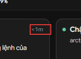
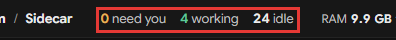
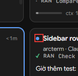
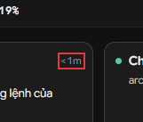
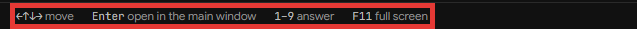
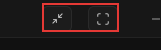
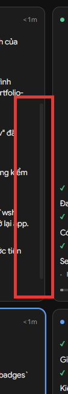

# Council: Sidecar: the second window that shows the agents on another screen (wall of agent cards)

You asked: council review tính năng sidecar này đi

## Memory

### Agreed

- Agent đang hỏi bạn phải luôn hiện trên Sidecar, bất kể bộ lọc project hay lane, và agent bạn chủ động ẩn thì giữ ẩn.
- Ngưỡng 1100px không được nhốt màn hình scale cao trong form nhỏ.
- Phím 1–9 không được trả lời nhầm một ask của agent.
- Tường hiện trông giống cockpit và khó nhìn.

### Open

- Ngưỡng 60 giây mất liên lạc của tường có bị WebView2 kéo giãn khi cửa sổ chính thu nhỏ hoặc ẩn xuống tray hay không, cần đo cả hai kiểu ẩn trước khi chốt.
- Snapshot của Sidecar có chở được số đếm việc chờ bạn ở Jarvis (gate, run chờ land, escalation) hay không, chưa ai kiểm tra code.
- Tường xếp thẻ theo trạng thái (hỏi, review, working) ra sao vẫn chưa ai đọc trong code.

**Sidecar dùng được, nhưng phải sửa trước: ask không được bị lọc mất, phím 1–9 không trả lời nhầm câu, màn scale cao phải thấy tường.**

Cả bốn chuyên gia (cùng một model) đồng ý: một ask bị lọc âm thầm là lỗi nặng nhất, và ngưỡng 1100px phải sửa. Chưa ai đo WebView2 có bóp timer khi cửa sổ bị thu nhỏ hay ẩn xuống tray, nên hướng 'tường biết mình đã cũ' còn treo. Hội đồng thiếu một người hiểu host Tauri/WebView2 trên Windows để chạy phép đo đó.

## Directions

1. **Key 1–9 must answer the ask the person actually saw** (Agreed)
   From P16 (Tìm bug).
   This is the only direction with a data-loss outcome. The answer act carries only an agent id and an option number (frontend/app/cockpit/sidecarbridgemodel.ts:96, :118). The bridge checks that number against the snapshot it already sent and applies it to the agent's live ask (frontend/app/cockpit/sidecarbridge.tsx:456, frontend/app/view/agents/askanswer.ts:33). Snapshots are throttled to 500 ms (frontend/app/cockpit/sidecarbridgemodel.ts:26), so a new question can take the old number. A wrong answer to an irreversible ask such as deleting a branch has no undo. The race is unlikely, but the fix is cheap. Stances: Tìm bug raised it, UX accepted it from the code, and nobody challenged it. 2 experts, 1 model. Label: Read code, and no test was run against the race.
   First step: Add the ask's sent key (or its question text) to the answer act in sidecarbridgemodel.ts. Have the bridge refuse an answer whose key differs from the live ask, and have the tile show an 'Ask changed' line. Add a model test for the mismatch case.
   Stances: UX accept.

2. **An asking agent always shows on the wall and in the small form** (Agreed)
   From P1 (UX), P15 (Tìm bug).
   This breaks the core flow, and the council already agreed on it: an asking agent always shows, and an agent the person hid on purpose stays hidden. The title bar counts the whole roster, but the wall and the small form draw only tiles that passed the Cockpit's filter (frontend/app/cockpit/sidecarsnapshot.ts:240, :248, :251). With a project filter set or the agent in the Background lane, the bar says '1 need you' while the small form says 'Nothing waits on you.' (frontend/app/cockpit/sidecarsmall.tsx:93; screenshot:sidecar-wall.png#counts@0.08,0.008,0.11,0.022). Go ran the snapshot tests and they passed. Their wallAgentIds cases state that the wall follows the project filter and leaves out the Background lane (frontend/app/cockpit/sidecarsnapshot.test.ts:439). So this behaviour is pinned by a test, not an oversight, and the fix must change that test. Stances: UX and Tìm bug each raised it and accepted the other's version. Đo RAM picked it and adds a condition: the filter rule must have one source, so that a narrower snapshot build never trims asks back out (frontend/app/cockpit/sidecarbridge.tsx:322). Khách picked it. 4 experts, 1 model. Label: Ran.
   First step: Change wallAgentIds (sidecarsnapshot.ts:248) to keep asking agents regardless of project filter or lane, still dropping user-hidden ones. Flip the 'follows the Cockpit's project filter and Live only' test to cover an asking agent. Have the small form say how many asks are hidden instead of 'Nothing waits on you.'

3. **A high-scale full-screen Sidecar must show the wall, not the small form** (Agreed)
   From P18 (Tìm bug).
   This breaks a flow, and the council already agreed on it. The layout is chosen from innerWidth in CSS px against an 1100 px threshold (frontend/app/cockpit/sidecarlayout.ts:12, frontend/tauri/sidecar.tsx:84). It does not use the host's small flag or the person's choice. So a 1920 px screen at 175% scale (about 1097 CSS px) gets the small form even full screen, and every working tile is hidden. The same root cause leaves the S button unlit while the small form is drawn (frontend/app/cockpit/sidecartitlebar.tsx:149). Stances: Tìm bug raised it, Khách accepted it from the code. 2 experts, 1 model. Label: Read code. The scale table is arithmetic and was not tried on a real 175% display.
   First step: In sidecarlayout.ts, return the wall for a maximized or full-screen window regardless of CSS width, or take the host's small flag as the input. Add a unit case for the 1097 px width.
   Stances: Khách accept.

4. **Measure WebView2's hidden-window timers, then let the wall know when it has gone stale** (Agreed)
   From P3 (UX), P17 (Tìm bug), P12 (Đo RAM).
   The wall can show a wrong state: it keeps looking alive while the main window is stuck. The page only listens for snapshots and adds to every age each 30 s even when nothing new arrives (frontend/tauri/sidecar.tsx:117, :155). The bridge also sends nothing when the data is unchanged (frontend/app/cockpit/sidecarbridgemodel.ts:229). A related suspicion is that the 5 s machine read runs on the main window's timer (frontend/app/cockpit/sidecarbridge.tsx:369). The strain model treats reads more than 15 s apart as a break and resets the 120 s CPU count (frontend/app/cockpit/sidecarstrainmodel.ts:18, :96). If WebView2 throttles a minimized or tray-hidden main window, which the spec allows (src-tauri/src/sidecar.rs:6), the CPU band could never fire. On cost, the bridge keeps feeding a minimized Sidecar from hello until the window is destroyed (frontend/app/cockpit/sidecarbridge.tsx:9, :432, :593). All three rest on the same unmeasured question, which the council left open: does WebView2 stretch timers or report hidden for a minimized or tray-hidden window? Stances: UX wants a heartbeat and a 'Lost contact' state. Đo RAM agrees but says to add no new timer: ride the existing 5 s read and 30 s age timer and send a small ping, not a snapshot. Đo RAM also wants both hide modes measured first. Tìm bug calls the band issue a suspicion, not a finding. UX says pausing the feed is only safe after the measurement and together with a lost-contact sign. 3 experts, 1 model. Label: Read code, and nothing was measured.
   First step: Run the single measurement Đo RAM laid out. Minimize, then cover, the Sidecar and log its visibilityState and the snapshot and read counts over 10 min. Then minimize, then tray-hide, the main window for at least 6 min and log the gaps between machine reads at sidecarbridge.tsx:369.

5. **Say what the wall leaves out: explain and link the idle count, and drop the 'every agent' promise** (Agreed)
   From P2 (UX), P7 (Khách).
   The person is shown a misleading state: the title bar reads 24 idle while the wall holds about 5 tiles, and nothing says that agents idle for over 5 minutes are hidden on purpose (screenshot:sidecar-wall.png#idle-count@0.08,0.008,0.11,0.022; frontend/app/cockpit/sidecarsnapshot.ts:213, :236; frontend/app/cockpit/sidecarwall.tsx:310). Meanwhile the button that opens Sidecar promises every agent at a glance (frontend/app/view/agents/cockpitsurface.tsx:1043, frontend/app/cockpit/sidecartitlebar.tsx:60). This is more than a wording change. It also makes the idle count open the main window's Idle list and adds a footer line while idle agents are hidden. The 16/11 decision not to draw idle tiles stands. Stances: UX and Khách each raised it and accepted the other's version. 2 experts, 1 model. Label: Read code.
   First step: Change the open button's tooltip at cockpitsurface.tsx:1043 to say it shows the running agents. Give the three title-bar counts a tooltip that says how many are on the wall and where the rest are listed.

## Also raised

- **Small form: a long name pushes the age out of the card** (from P6 (UX)): Make the name min-w-0 and truncated with a title, and the age shrink-0 (sidecarsmall.tsx:145). Tìm bug accepted it; it was not rendered.
- **S button: label it, show that it pins, and light it from the layout actually drawn** (from P5 (UX), P10 (Khách)): Use one word for both the label and the tooltip, mention the pin, and fix the unlit state when the window is already narrow first (UX, Khách).
- **Cap a scrolled-up tile's history** (from P13 (Đo RAM)): Cap loaded rows near 200 and return to the bottom after 10 idle minutes with an 'N new rows' chip. Handle the switch from memory to the file reader at the cap edge. The tests Go ran show folding with no cap.
- **Skip snapshot builds no one will send, and walk rows from the end** (from P11 (Đo RAM)): Walking from the end is safe. Skipping the build while a send is pending is not yet, because the build also updates kept rows, notes and the heavy poll (Tìm bug). The tests that passed only cover current behaviour.
- **Put a status word next to the age on wall tiles** (from P4 (UX), P8 (Khách)): Show 'working 3m' or 'review 12m' on the wall only, and give the selection ring a neutral colour so it is not confused with review. The suspected stateSince reset needs measuring first.
- **Make opening an agent discoverable, starting with the small form's focus** (from P9 (Khách)): Tell people about double-click and Enter. Tìm bug argues the real gap may be that the small form has no keyboard focus.
- **Rewrite the stale Sidecar row in RAM watch** (from P14 (Đo RAM)): Bring the part 2 row in line with the current design (snapshots no longer read the transcript tail, but scrolling up still reads the file) and fix one recipe for the day-long run.

## Ask next

- To Đo RAM: Đo giúp: thu nhỏ hoặc ẩn cửa sổ chính xuống tray thì khoảng cách giữa các lần đọc máy 5 giây giãn ra bao nhiêu?
- To Tìm bug: Form nhỏ ghim bên cạnh mà chưa có focus thì phím 1–9 và Enter còn trả lời được ask không?
- To Đo RAM: Bỏ build snapshot khi đang có lần gửi chờ có làm mất ghi chú hay poll nặng không, và làm sao cho an toàn?


## Matrix

| Proposal | UX | Đo RAM | Khách | Tìm bug | Outcome |
|---|---|---|---|---|---|
| P1 · Agent đang hỏi bạn không được biến mất khỏi Sidecar (Read code) | author | — | — | accept: | Direction 2 |
| P2 · Nói rõ cái gì không có trên tường, và sửa lời hứa 'every agent' (Read code) | author | — | accept: | — | Direction 5 |
| P3 · Tường treo cả ngày phải tự biết khi nó đã cũ (Read code) | author | challenge: Về RAM thì một nhịp chỉ là một dấu thời gian nên không đụng ngân sách 100 MB, mình đồng ý với mục tiêu. Nhưng đừng thêm… | — | — | Direction 4 |
| P4 · Trạng thái chỉ là chấm 7px, và tuổi không có chữ đi kèm (Read code) | author | — | accept: | — | Also raised |
| P5 · Nút S: ghi chữ, báo việc ghim, và sáng lên khi cửa sổ đã ở dạng nhỏ (Read code) | author | — | challenge: Bạn đặt nhãn là Compact, còn tooltip đang ghi Small form, pinned on top. Người mới sẽ gặp hai tên cho một nút, nên chọn… | — | Also raised |
| P6 · Form nhỏ: tên dài đẩy tuổi ra khỏi thẻ (Read code) | author | — | — | accept: | Also raised |
| P7 · Số 24 idle không bấm được, còn nút mở lại hứa 'mọi agent' (Read code) | accept: | — | author | — | Merged into direction 5 |
| P8 · Chấm màu và '<1m' không có chữ nào giải thích (Read code) | — | — | author | challenge: Mình ủng hộ thêm nhãn cạnh tuổi, nhưng nghi ngờ stateSince bị reset mới dựa trên một ảnh chụp. Bốn agent working vừa chạ… | Also raised |
| P9 · Mở agent cần bấm đúp, mà không chỗ nào nói, bản nhỏ còn không có footer (Read code) | — | — | author | challenge: Thêm 'Double-click open' vào footer chỉ chữa triệu chứng. Câu hỏi bạn tự nêu mới quyết định: form nhỏ nằm cạnh việc khác… | Also raised |
| P10 · Nút 'S' chỉ là hai mũi tên không nhãn, và nó âm thầm ghim cửa sổ (Read code) | challenge: Chữ 'Small' chỉ nói kích thước, không nói là ghim lên trên, nên người ta vẫn bị bất ngờ. Nút không sáng khi cửa sổ đã hẹ… | — | author | — | Also raised |
| P11 · Đừng build snapshot không ai gửi, và chỉ build hàng cho tile trên tường (Ran) | — | author | — | challenge: Nửa 'đi từ cuối khi lấy 8 hàng' thì an toàn, vì Pi giữ mọi dòng. Nửa 'bỏ build khi có timer chờ' thì chưa, vì build còn… | Also raised |
| P12 · Tạm dừng feed khi Sidecar bị thu nhỏ, và đo luôn khoảng cách timer của cửa sổ chính trong cùng lần chạy (Read code) | challenge: Lúc mở lại thì hello đã đòi snapshot mới, nên khoảnh khắc đó ổn. Nhưng nếu WebView2 báo ẩn nhầm khi bạn đang nhìn, tường… | author | — | — | Merged into direction 4 |
| P13 · Cap a tile's scrolled-up history (Ran) | challenge: Quay về đáy sau một lúc là đúng, vì tile cuộn lên đang đứng ở nội dung cũ trên một màn hình để liếc. Nhưng 'vài phút' dễ… | author | — | challenge: Cap thì được, nhưng cuộn lên đang tách hai nguồn: test answerOlder ghi bộ nhớ được ưu tiên hơn file và con trỏ trả về ng… | Also raised |
| P14 · Fix the stale part 2 row in RAM watch (Read code) | — | author | — | challenge: Sửa hàng cũ là đúng: test snapshot cho agent không có entries, previousInfo hay hàng giữ lại ra 0 hàng, tức lúc dựng sna… | Also raised |
| P15 · Ask bị lọc âm thầm khỏi Sidecar: project khác bộ lọc, lane Background (Ran) | accept: | — | — | author | Merged into direction 2 |
| P16 · Phím 1–9 trả lời mà không nói là trả lời câu hỏi nào (Read code) | accept: | — | — | author | Direction 1 |
| P17 · Band RAM và CPU sống bằng timer của cửa sổ chính, mà cửa sổ đó được phép ẩn (Read code) | — | challenge: Đo cái này là đúng, nhưng bạn nên đo cả hai kiểu ẩn: thu nhỏ và ẩn xuống tray, vì spec nói tray còn phép đo của bạn chỉ… | — | author | Merged into direction 4 |
| P18 · Ngưỡng 1100px nhốt màn hình scale cao trong form nhỏ (Read code) | — | — | accept: | author | Direction 3 |

## Cite check

Go read every `path:line` this report cites, with no model: 57 places, cited 129 times. 42 hold (the file is there, the line is in it, and a keyword of a sentence citing it is on or within 3 lines of it), 9 have no such keyword near the line, 6 are wrong, 0 are outside the folders this council reads.

Wrong:

- `sidecarsnapshot.ts:248` (Directions): file not found
- `sidecarbridge.tsx:369` (Directions; Đo RAM proposes · P12): file not found
- `cockpitsurface.tsx:1043` (Directions): file not found
- `sidecarsmall.tsx:145` (Also raised): file not found
- `sidecarbridge.tsx:9` (Đo RAM proposes · P12): file not found
- `sidecarhistory.ts:7` (Tìm bug has doubts · P13): file not found

No keyword near the line (read these by hand):

- `frontend/app/view/agents/askanswer.ts:33` (Directions; Tìm bug proposes · P16): looked for checks, number, already, applies, answer, option near line 33
- `frontend/app/cockpit/sidecarbridge.tsx:322` (Directions; Đo RAM proposes · P11; Đo RAM has doubts · P17; Tìm bug has doubts · P11): looked for picked, condition, filter, source, narrower, trims near line 322
- `frontend/app/cockpit/sidecarbridgemodel.ts:229` (Directions; UX proposes · P3; UX replies): looked for sends, nothing, unchanged, 30, 15, 60 near line 229
- `frontend/app/cockpit/sidecartitlebar.tsx:60` (Directions; Khách proposes · P7): looked for meanwhile, button, opens, promises, glance, 24 near line 60
- `frontend/tauri/sidecar.tsx:155` (UX proposes · P3; Đo RAM has doubts · P3; UX has doubts · P12): looked for 30, 15, 60, contact, update, 100 near line 155
- `frontend/app/cockpit/sidecarwall.tsx:376` (Khách proposes · P9): looked for footer, enter, double-click, 0.981, 0.216, 0.014 near line 376
- `frontend/app/cockpit/sidecarsmall.tsx:85` (Khách proposes · P9; Tìm bug has doubts · P9): looked for footer, enter, double-click, 0.981, 0.216, 0.014 near line 85
- `frontend/app/cockpit/sidecarbridgemodel.ts:232` (Đo RAM proposes · P11; Tìm bug has doubts · P11): looked for store, trailing, roster, nguon, allocation, churn near line 232
- `frontend/app/cockpit/sidecarbridge.tsx:593` (Đo RAM proposes · P12): looked for khoang, hello, 432, 593, pause, hidden near line 593

## The discussion

- **You** sets the goal
  council review tính năng sidecar này đi
- **UX** proposes · P1 · Agent đang hỏi bạn không được biến mất khỏi Sidecar
  Title bar đếm cả roster, còn tường và form nhỏ chỉ vẽ tile đã qua bộ lọc của Cockpit. Nếu bạn đang lọc một project ở cửa sổ chính, hoặc agent nằm ở Background, title bar ghi '1 need you' mà form nhỏ lại ghi 'Nothing waits on you.' ==Form nhỏ sinh ra chỉ để báo cái gì đang chờ bạn, mà nó lại im lặng đúng với agent đó.== Mình đề xuất agent đang hỏi không bao giờ bị lọc ra. Mình chưa đọc filterAgents và hiddenAgentIds, nên cần người kiểm xem hai hàm đó đã chừa agent asking chưa.
  Evidence: frontend/app/cockpit/sidecarsnapshot.ts:240; frontend/app/cockpit/sidecarsnapshot.ts:251; frontend/app/cockpit/sidecarsmall.tsx:93; screenshot:sidecar-wall.png#counts@0.08,0.008,0.11,0.022
  
  Check: Read code
- **UX** proposes · P2 · Nói rõ cái gì không có trên tường, và sửa lời hứa 'every agent'
  Trong ảnh title bar ghi 24 idle, nhưng tường chỉ có 1 tile review. 23 agent còn lại không có chỗ nào để thấy hay bấm. Nút mở Sidecar thì hứa 'every agent at a glance'. ==Mình đề xuất đổi chữ nút thành đúng thứ nó cho xem, và biến số idle thành chỗ bấm được để mở danh sách Idle ở cửa sổ chính.== Quyết định hôm 16/11 là không vẽ tile idle vẫn giữ nguyên.
  Evidence: frontend/app/view/agents/cockpitsurface.tsx:1043; frontend/app/cockpit/sidecarsnapshot.ts:236; screenshot:sidecar-wall.png#idle-count@0.08,0.008,0.11,0.022
  
  Check: Read code
- **UX** proposes · P3 · Tường treo cả ngày phải tự biết khi nó đã cũ
  Trang chỉ nghe snapshot, và cứ 30 giây lại cộng tuổi dù không có snapshot nào mới. Bridge cũng không gửi gì khi dữ liệu y hệt. Nếu cửa sổ chính treo, tường vẫn trông như đang sống và tuổi vẫn nhảy. ==Một màn hình bị bỏ mặc cả ngày phải tự nhận ra khi nó đã mù.== Mình đề xuất bridge gửi một nhịp mỗi 15 giây. Trang im quá 60 giây thì làm mờ tường và ghi 'Lost contact · last update 3 min ago'.
  Evidence: frontend/tauri/sidecar.tsx:117; frontend/app/cockpit/sidecarbridgemodel.ts:229; frontend/tauri/sidecar.tsx:155
  Check: Read code
- **UX** proposes · P4 · Trạng thái chỉ là chấm 7px, và tuổi không có chữ đi kèm
  Trong ảnh, 4 tile working và 1 tile review chỉ khác nhau chấm xanh lá và chấm xanh dương. Tuổi hiện trơn '<1m', không biết là tuổi của cái gì. Chấm review màu accent lại trùng màu viền chọn tile. ==Mình đề xuất ghi chữ trước tuổi, như 'working 4m', 'review 12m', 'idle 8m'.== Viền chọn đổi sang màu trung tính sáng để khỏi lẫn với review.
  Evidence: frontend/app/cockpit/sidecarwall.tsx:69; frontend/app/cockpit/sidecarwall.tsx:381; screenshot:sidecar-wall.png#review-dot@0.333,0.52,0.02,0.015; screenshot:sidecar-wall.png#selected-ring@0.01,0.51,0.315,0.455; screenshot:sidecar-wall.png#age@0.305,0.062,0.02,0.016
  
  
  
  Check: Read code
- **UX** proposes · P5 · Nút S: ghi chữ, báo việc ghim, và sáng lên khi cửa sổ đã ở dạng nhỏ
  Trên thanh tiêu đề, nút S và nút full screen đều là mũi tên co giãn, nằm sát nhau, và chữ giải thích chỉ nằm trong tooltip. Bấm S là cửa sổ co còn 340×440 và ghim lên trên, mà icon không nói gì về việc đó (frontend/app/cockpit/sidecartitlebar.tsx:190). Mình đề xuất thêm chữ 'Compact' cạnh icon ở thanh rộng, kèm hình ghim, vì chữ 'Small' một mình không nói tới ghim. Mình vừa thấy thêm một chỗ gãy: bố cục chọn theo bề ngang cửa sổ, nên kéo hẹp là đã ra bản nhỏ, mà nút vẫn ghi 'Small form, pinned on top' và chưa bật (frontend/app/cockpit/sidecartitlebar.tsx:149). ==Trạng thái của nút phải theo bố cục đang vẽ, không theo việc bạn có bấm nó hay không.== Nếu không thì cùng một màn hình có hai câu trả lời cho 'đang ở dạng nào'.
  Evidence: frontend/app/cockpit/sidecartitlebar.tsx:190; screenshot:sidecar-wall.png#s-and-fullscreen@0.855,0.004,0.06,0.03
  
  Check: Read code
- **UX** proposes · P6 · Form nhỏ: tên dài đẩy tuổi ra khỏi thẻ
  Trên tường tên tile có truncate, nhưng thẻ của form nhỏ để tên shrink-0. Tên ở đây là tiêu đề hội thoại, như 'Missing Waveterm paste attachments' trong ảnh, dài hơn nhiều so với chỗ 340px chia. Tên dài sẽ ép project và tuổi ra khỏi thẻ, mà danh sách lại overflow-x-hidden nên tuổi mất luôn. ==Tuổi là thứ để biết agent nào chờ lâu nhất.== Mình đề xuất tên min-w-0 truncate có title, còn tuổi shrink-0. Mình chưa render thử.
  Evidence: frontend/app/cockpit/sidecarsmall.tsx:145; screenshot:sidecar-wall.png#long-title@0.67,0.063,0.17,0.02; weak: Not rendered; the overflow is inferred from class names, not seen with a long title in the small form.
  
  Check: Read code
- **Khách** proposes · P7 · Số 24 idle không bấm được, còn nút mở lại hứa 'mọi agent'
  Mình mở Sidecar lần đầu và thấy 24 idle ở thanh trên, mà tường chỉ có 5 ô. Con số đó không bấm được và không có chú thích. Nút mở Sidecar còn hứa mọi agent trong một cái nhìn. ==Mình sẽ tưởng Sidecar làm rơi agent, vì không đâu nói rằng agent idle quá 5 phút bị giấu có chủ ý.== Mình đề xuất ba việc nhỏ:

  1. Cho ba con số một tooltip, kiểu `24 idle, 5 đang hiện trên tường, còn lại nằm trong danh sách Idle của cửa sổ chính`.
  2. Khi có idle bị giấu, thêm một dòng ở footer nói đúng điều đó.
  3. Đổi tooltip nút mở thành `các agent đang chạy`, đừng nói `mọi agent`.
  Evidence: screenshot:sidecar-wall.png#idle-count@0.083,0.009,0.103,0.019; frontend/app/view/agents/cockpitsurface.tsx:1043; frontend/app/cockpit/sidecartitlebar.tsx:60; frontend/app/cockpit/sidecarsnapshot.ts:213; frontend/app/cockpit/sidecarwall.tsx:310
  
  Check: Read code
- **Khách** proposes · P8 · Chấm màu và '<1m' không có chữ nào giải thích
  Chỉ ô đang hỏi mới nói trạng thái bằng chữ, là WAITING ON YOU. Các ô còn lại chỉ có một chấm màu và không có bảng chú giải. Mình không đoán được chấm xanh dương là gì, vì chữ review không có trên ô nào. Cái `<1m` bên phải cũng đổi nghĩa theo trạng thái:

  | Trạng thái | Chấm | `<1m` đếm gì |
  |---|---|---|
  | asking | vàng | thời gian bị chặn |
  | working | xanh lá | thời gian đang làm |
  | review | xanh dương | thời gian idle |
  | idle | xám | thời gian idle |

  ==Mình đề xuất thêm một từ cạnh tuổi, như `working 3m` hay `review 1m`, vì header còn thừa chỗ.== Cả 4 agent working đều ghi `<1m`, nên mình còn nghi nó reset mỗi lượt.
  Evidence: screenshot:sidecar-wall.png#blue-dot@0.337,0.524,0.008,0.012; screenshot:sidecar-wall.png#age-working@0.305,0.063,0.014,0.014; frontend/app/cockpit/sidecarwall.tsx:69; frontend/app/cockpit/sidecarsnapshot.ts:112; weak: The suspicion that stateSince resets each turn rests on one screenshot where four agents read '<1m'; no agent was followed through a turn.
  
  
  Check: Read code
- **Khách** proposes · P9 · Mở agent cần bấm đúp, mà không chỗ nào nói, bản nhỏ còn không có footer
  Mình bấm vào một ô thì chỉ thấy viền xanh hiện lên, ô không mở gì cả. Muốn mở agent phải bấm đúp hoặc nhấn Enter. Footer ghi phím nhưng không nhắc bấm đúp, và bản nhỏ không có footer nào hết:

  | Chỗ | Có kể phím | Có kể bấm đúp |
  |---|---|---|
  | Footer của tường | có | không |
  | Bản nhỏ | không | không |

  ==Mình sẽ nghĩ ô chỉ để xem rồi thôi, trong khi bản nhỏ là chỗ người ta đặt cạnh việc đang làm.== Thêm `Double-click open` vào footer, và một dòng mờ ở cuối bản nhỏ.
  Evidence: screenshot:sidecar-wall.png#footer@0.008,0.981,0.216,0.014; frontend/app/cockpit/sidecarwall.tsx:376; frontend/app/cockpit/sidecarwall.tsx:648; frontend/app/cockpit/sidecarsmall.tsx:85; docs/superpowers/specs/2026-11-13-sidecar-design.md:123
  
  Check: Read code
- **Khách** proposes · P10 · Nút 'S' chỉ là hai mũi tên không nhãn, và nó âm thầm ghim cửa sổ
  Spec gọi nó là nút S, nhưng trên màn hình không có chữ S nào. Mình chỉ thấy hai mũi tên nhỏ ở góc phải, và tên chỉ hiện khi rê chuột. Bấm vào là cửa sổ co còn 340×440 và ghim lên trên luôn, việc mình không đoán được từ icon. ==Mình đề xuất đặt chữ `Small` cạnh icon, vì thanh tiêu đề còn rất nhiều chỗ trống.== Một chỗ nữa làm mình rối. Kéo cửa sổ hẹp lại thì bố cục đã là bản nhỏ, mà nút vẫn ghi `Small form, pinned on top` và chưa được bật.
  Evidence: screenshot:sidecar-wall.png#s-and-fullscreen-buttons@0.860,0.005,0.038,0.023; frontend/app/cockpit/sidecartitlebar.tsx:190; frontend/app/cockpit/sidecartitlebar.tsx:149
  
  Check: Read code
- **Khách** agrees · on P2 · Nói rõ cái gì không có trên tường, và sửa lời hứa 'every agent'
  Evidence: screenshot:sidecar-wall.png#idle-count@0.08,0.008,0.11,0.022; frontend/app/view/agents/cockpitsurface.tsx:1043
  
  Check: Read code
- **Khách** agrees · on P4 · Trạng thái chỉ là chấm 7px, và tuổi không có chữ đi kèm
  Evidence: screenshot:sidecar-wall.png#review-dot@0.333,0.52,0.02,0.015; frontend/app/cockpit/sidecarwall.tsx:69
  
  Check: Read code
- **Khách** has doubts · on P5 · Nút S: ghi chữ, báo việc ghim, và sáng lên khi cửa sổ đã ở dạng nhỏ
  Bạn đặt nhãn là Compact, còn tooltip đang ghi Small form, pinned on top. Người mới sẽ gặp hai tên cho một nút, nên chọn một từ cho cả nhãn lẫn tooltip.
  Evidence: frontend/app/cockpit/sidecartitlebar.tsx:190; screenshot:sidecar-wall.png#s-and-fullscreen@0.855,0.004,0.06,0.03
  
  Check: Read code
- **Đo RAM** proposes · P11 · Đừng build snapshot không ai gửi, và chỉ build hàng cho tile trên tường
  Mỗi lần store đổi, bridge build cả snapshot rồi mới hỏi có gửi không. Khi đã có một lần gửi trailing đang chờ thì câu trả lời luôn là không, nên bản build đó thành rác. Bản build còn rộng hơn cái tường.

  Sau khi đọc các đề xuất khác, mình sửa một chỗ: thanh trên đếm cả roster, còn tường chỉ vẽ tile đã qua bộ lọc. Nên ý 'chỉ build agent trên tường' phải tách đôi. Bảng này cho thấy bước nào thu hẹp được và bước nào phải giữ cả roster.

  | Bước | Hiện giờ | Cần |
  |---|---|---|
  | Số đếm thanh trên | cả roster | cả roster, chỉ đếm, không có hàng |
  | Agent có hàng | cả roster, cắt sau | chỉ id trên tường, theo đúng luật lọc của tường |
  | Hàng mỗi tile | đi hết rồi giữ 8 | đi từ cuối |
  | Khi timer đang chờ | build vẫn chạy | bỏ qua |

  ==Luật lọc phải có một nguồn duy nhất, vì nếu ai đó sửa để agent đang hỏi luôn lên tường thì tập id rộng ra, và bản build hẹp không được tự cắt mất chúng.== Đây vẫn là allocation churn trong cửa sổ chính, nơi RAM watch đã ghi chuyện thu gom muộn. Pi giữ mọi dòng nên bước đi của nó lớn theo phiên. Mình sẽ lấy heap sampling profile 60 giây với 4 agent working, so Sidecar mở với đóng.
  Evidence: frontend/app/cockpit/sidecarbridge.tsx:322; frontend/app/cockpit/sidecarbridgemodel.ts:232; frontend/app/cockpit/sidecarsnapshot.ts:92; frontend/app/cockpit/sidecarsnapshot.ts:202; frontend/app/view/agents/livetranscript.ts:88; screenshot:sidecar-wall.png#counts-vs-tiles@0.08,0.008,0.11,0.022; weak: The allocation churn in the main window is not measured; the passing bridge tests cover current behaviour, not a skipped build.
  
  Check: Ran
  Verify `npx vitest run frontend/app/cockpit/sidecarbridgemodel.test.ts`: passed, as its author expected
  ```text
   ✓ frontend/app/cockpit/sidecarbridgemodel.test.ts > machineOf > gives the same machine for readings that only jitter, so a poll does not re-emit the snapshot 1ms
   ✓ frontend/app/cockpit/sidecarbridgemodel.test.ts > machineOf > leaves swapUsed out when nothing is in swap and cpuPct out before the first CPU reading 1ms
   ✓ frontend/app/cockpit/sidecarbridgemodel.test.ts > readingOf and applyPressure > reads the pressure word, the memory and the CPU of a machine reading 0ms
   ✓ frontend/app/cockpit/sidecarbridgemodel.test.ts > readingOf and applyPressure > a memorypressure event moves the level and the memory and keeps the last poll's CPU and total 1ms
   ✓ frontend/app/cockpit/sidecarbridgemodel.test.ts > readingOf and applyPressure > an event between two polls does not restart the 120 s CPU streak 3ms
   ✓ frontend/app/cockpit/sidecarbridgemodel.test.ts > readingOf and applyPressure > answers nothing for an event heard before any poll: there is no total or CPU to carry 0ms
   ✓ frontend/app/cockpit/sidecarbridgemodel.test.ts > readingOf and applyPressure > ignores the fields of a malformed event 0ms
   ✓ frontend/app/cockpit/sidecarbridgemodel.test.ts > heavyPolls > runs no poll while there is no strain 1ms
   ✓ frontend/app/cockpit/sidecarbridgemodel.test.ts > heavyPolls > polls the consumers when the band measures by RAM, the CPU reading when by CPU 0ms
   ✓ frontend/app/cockpit/sidecarbridgemodel.test.ts > heavyPolls > polls only the consumers when both are up: RAM is the one that kills processes 0ms
   ✓ frontend/app/cockpit/sidecarbridgemodel.test.ts > readingFresh > takes a reading younger than HEAVY_STALE_MS, up to and including it 1ms
   ✓ frontend/app/cockpit/sidecarbridgemodel.test.ts > readingFresh > refuses an older one and one that never landed: a panel read from an hour ago names no one 1ms
   ✓ frontend/app/cockpit/sidecarbridgemodel.test.ts > roundHeavy > rounds RAM as the band prints it and CPU to a whole percent, the process's figures too 1ms
   ✓ frontend/app/cockpit/sidecarbridgemodel.test.ts > roundHeavy > gives two readings that jitter the same rows, so a poll does not re-emit the snapshot 1ms
   ✓ frontend/app/cockpit/sidecarbridgemodel.test.ts > roundHeavy > keeps a positive CPU share at 1% at least, and leaves absent fields absent 0ms
   ✓ frontend/app/cockpit/sidecarbridgemodel.test.ts > roundHeavy > does not touch the rows it is given 0ms
   ✓ frontend/app/cockpit/sidecarbridgemodel.test.ts > strainOf and runningJobs > builds the snapshot's strain from the model's state, the counts and the heavy rows 0ms
   ✓ frontend/app/cockpit/sidecarbridgemodel.test.ts > strainOf and runningJobs > names the measure the band's heavy rows came from, and rounds the CPU percent it says 0ms
   ✓ frontend/app/cockpit/sidecarbridgemodel.test.ts > strainOf and runningJobs > counts the running jobs of the queue, none when it has not been read 0ms
   ✓ frontend/app/cockpit/sidecarbridgemodel.test.ts > a heavy row's note > starts empty and is kept while the band's level and the agent's place in it stay 0ms
   ✓ frontend/app/cockpit/sidecarbridgemodel.test.ts > a heavy row's note > is cleared when the band's level changes, and when the band goes 0ms
   ✓ frontend/app/cockpit/sidecarbridgemodel.test.ts > a heavy row's note > is dropped when its agent leaves the band, the others kept 0ms
   ✓ frontend/app/cockpit/sidecarbridgemodel.test.ts > a heavy row's note > is replaced by the next outcome of the same row, and setNote does not mutate 0ms
   ✓ frontend/app/cockpit/sidecarbridgemodel.test.ts > a heavy row's note > attaches to the rows that have one and leaves the others without a note field 0ms
   ✓ frontend/app/cockpit/sidecarbridgemodel.test.ts > sleepNote and stopNote > words what each Sleep outcome did, as the row says it 0ms
   ✓ frontend/app/cockpit/sidecarbridgemodel.test.ts > sleepNote and stopNote > takes the server's text from a refused Stop 0ms
   ✓ frontend/app/cockpit/sidecarbridgemodel.test.ts > sleepNote and stopNote > says something for a refusal with no text, and cuts a long one 0ms
   ✓ frontend/app/cockpit/sidecarbridgemodel.test.ts > answerOlder > pages the rows the main window holds for an agent that has some, past what the tile shows 5ms
   ✓ frontend/app/cockpit/sidecarbridgemodel.test.ts > answerOlder > hands the cursor back to the page unchanged in the answer, and to the reader 4ms
   ✓ frontend/app/cockpit/sidecarbridgemodel.test.ts > answerOlder > reads the transcript file for an agent with nothing in memory 1ms
   ✓ frontend/app/cockpit/sidecarbridgemodel.test.ts > answerOlder > answers rows [] and next null when the read fails, and logs it: no error loop 3ms
   ✓ frontend/app/cockpit/sidecarbridgemodel.test.ts > answerOlder > answers nothing earlier for an agent with neither entries in memory nor a transcript path 1ms
   ✓ frontend/app/cockpit/sidecarbridgemodel.test.ts > answerOlder > prefers memory over the file when both exist: the main window's rows are the ones the tile shows 0ms

   Test Files  1 passed (1)
        Tests  75 passed (75)
     Start at  14:09:10
     Duration  1.71s (transform 360ms, setup 0ms, collect 381ms, tests 53ms, environment 0ms, prepare 139ms)

  JUNIT report written to <arc-wt>/council-0a40209110ce9b44/test-results.xml
  ```
- **Đo RAM** proposes · P12 · Tạm dừng feed khi Sidecar bị thu nhỏ, và đo luôn khoảng cách timer của cửa sổ chính trong cùng lần chạy
  Khi Sidecar bị thu nhỏ hoặc bị che, cửa sổ chính vẫn tốn y như lúc có người đang xem. Bridge sống từ hello đến khi cửa sổ bị huỷ (sidecarbridge.tsx:9, :432, :593), và trang không bao giờ báo là nó đang ẩn. Nên snapshot, lần đọc máy mỗi 5 giây và các poll band cứ chạy cho không ai. Mình sẽ cho trang gửi pause khi nó ẩn và hello khi hiện lại, hello vốn đã ép một snapshot mới. ==Mình chưa xác nhận WebView2 có báo cửa sổ thu nhỏ là hidden không, nên đo cái đó trước.==

  Sau khi đọc đề xuất về band RAM và CPU, mình gộp hai phép đo vào một lần chạy. Cả hai cùng hỏi WebView2 có coi cửa sổ thu nhỏ là ẩn không, và có bóp timer của nó không.

  1. Thu nhỏ Sidecar, ghi visibilityState của nó, đếm số snapshot gửi đi và số lần đọc máy trong 10 phút.
  2. Che nó bằng một cửa sổ khác và lặp lại.
  3. Làm lại với cửa sổ chính bị thu nhỏ rồi ẩn xuống tray, ít nhất 6 phút, ghi khoảng cách giữa các lần đọc máy (sidecarbridge.tsx:369).
  4. Thêm pause và so các số đếm.
  Evidence: frontend/app/cockpit/sidecarbridge.tsx:9; frontend/app/cockpit/sidecarbridge.tsx:432; frontend/app/cockpit/sidecarbridge.tsx:593; weak: That a minimized Sidecar keeps the full feed running is read from code, but no snapshot or read counts were taken, and WebView2 reporting minimized as hidden is unconfirmed.
  Check: Read code
- **Đo RAM** proposes · P13 · Cap a tile's scrolled-up history
  A tile you scroll up keeps every row the agent writes afterwards, and nothing caps it. Rows that slide out of the snapshot are folded into the loaded history, and each fold copies the whole array. All of it is drawn as DOM with no virtualization. The tiles in the screenshot already carry a scroller, so scrolling up is an everyday move. ==If someone scrolls up, goes to lunch and leaves a working agent, that one tile grows all day on a page budgeted at 100 MB.== I'd cap the loaded rows near 200 and snap the tile back to the bottom after a few idle minutes, which drops the history as the spec intends. To size it, I'd run a fixture agent that writes a row every 10 s with one tile scrolled up, and sample the renderer every 30 s for 2 h.
  Evidence: frontend/app/cockpit/sidecarwallmodel.ts:297; frontend/app/cockpit/sidecarwallmodel.ts:250; frontend/app/cockpit/sidecarwall.tsx:526; screenshot:sidecar-wall.png#tile-scroller@0.30,0.19,0.03,0.30; weak: 'Grows all day on a 100 MB page' has no measurement; the tests Go ran show folding appends rows but never touch a cap or memory size.
  
  Check: Ran
  Verify `npx vitest run frontend/app/cockpit/sidecarwallmodel.test.ts`: passed, as its author expected
  ```text
   ✓ frontend/app/cockpit/sidecarwallmodel.test.ts > wallShape on other windows > whatever the size, a fitted wall holds every tile at or above the floor within the area 12ms
   ✓ frontend/app/cockpit/sidecarwallmodel.test.ts > wallShape on other windows > messages per tile follow the tile's height, within the cap of 8 0ms
   ✓ frontend/app/cockpit/sidecarwallmodel.test.ts > wallShape on other windows > the tile name is larger when there are only a few tiles 0ms
   ✓ frontend/app/cockpit/sidecarwallmodel.test.ts > moveSelection > left and right step by one, in reading order, and stop at the ends 0ms
   ✓ frontend/app/cockpit/sidecarwallmodel.test.ts > moveSelection > up and down step by one row 0ms
   ✓ frontend/app/cockpit/sidecarwallmodel.test.ts > moveSelection > a move off the grid stays where it is 0ms
   ✓ frontend/app/cockpit/sidecarwallmodel.test.ts > moveSelection > one column is a list 0ms
   ✓ frontend/app/cockpit/sidecarwallmodel.test.ts > moveSelection > no tiles, or an index past the end, comes back inside the list 0ms
   ✓ frontend/app/cockpit/sidecarwallmodel.test.ts > resolveSelection > keeps the selected agent by id when the order changes 0ms
   ✓ frontend/app/cockpit/sidecarwallmodel.test.ts > resolveSelection > an agent that leaves moves the selection to the same index 0ms
   ✓ frontend/app/cockpit/sidecarwallmodel.test.ts > resolveSelection > clamps to the last tile when the list got shorter than the index 0ms
   ✓ frontend/app/cockpit/sidecarwallmodel.test.ts > resolveSelection > selects the first tile when nothing was selected, and none when nothing is there 0ms
   ✓ frontend/app/cockpit/sidecarwallmodel.test.ts > resolveSelection > an id the previous list never held falls back to the first tile 0ms
   ✓ frontend/app/cockpit/sidecarwallmodel.test.ts > the age text > formats under a minute, minutes, hours with minutes, and days 0ms
   ✓ frontend/app/cockpit/sidecarwallmodel.test.ts > the age text > adds the time since the snapshot arrived to the snapshot's own now 0ms
   ✓ frontend/app/cockpit/sidecarwallmodel.test.ts > the age text > has no age without a since, and never goes negative 0ms
   ✓ frontend/app/cockpit/sidecarwallmodel.test.ts > keys > maps arrows, Enter and 1-9; anything else is not the wall's 0ms
   ✓ frontend/app/cockpit/sidecarwallmodel.test.ts > keys > answers only an answerable ask, not yet sent, with that option on it 0ms
   ✓ frontend/app/cockpit/sidecarwallmodel.test.ts > scrollEdges > is at the top at 0 and at the bottom when the viewport reaches the content's end 0ms
   ✓ frontend/app/cockpit/sidecarwallmodel.test.ts > scrollEdges > counts a position within the tolerance as the end, and one just past it as not 0ms
   ✓ frontend/app/cockpit/sidecarwallmodel.test.ts > scrollEdges > puts a list that does not overflow at both ends 0ms
   ✓ frontend/app/cockpit/sidecarwallmodel.test.ts > a tile's history > asks for the page above the snapshot's rows first (before null), once 0ms
   ✓ frontend/app/cockpit/sidecarwallmodel.test.ts > a tile's history > joins an answer's rows above the loaded ones and asks the next cursor after it 0ms
   ✓ frontend/app/cockpit/sidecarwallmodel.test.ts > a tile's history > ends at a null next: the start, and nothing more is asked 0ms
   ✓ frontend/app/cockpit/sidecarwallmodel.test.ts > a tile's history > drops a stale answer: none is out, or it answers another cursor 0ms
   ✓ frontend/app/cockpit/sidecarwallmodel.test.ts > a tile's history > an empty answer with a cursor changes nothing but lets the same cursor be asked again 0ms
   ✓ frontend/app/cockpit/sidecarwallmodel.test.ts > slidOut and foldSlid > finds the rows that left the top when new rows arrived at the bottom 0ms
   ✓ frontend/app/cockpit/sidecarwallmodel.test.ts > slidOut and foldSlid > sees the slide although the last row changed in place (a tool row that got its result) 0ms
   ✓ frontend/app/cockpit/sidecarwallmodel.test.ts > slidOut and foldSlid > finds nothing when the window did not move, or the rows do not line up 0ms
   ✓ frontend/app/cockpit/sidecarwallmodel.test.ts > slidOut and foldSlid > takes a window that only grew, or that changed only in its last row, for no slide (even a repeating transcript) 0ms
   ✓ frontend/app/cockpit/sidecarwallmodel.test.ts > slidOut and foldSlid > does not take one repeated row for a slide 0ms
   ✓ frontend/app/cockpit/sidecarwallmodel.test.ts > slidOut and foldSlid > appends the rows to a history that has loaded rows, and leaves one without alone 0ms
   ✓ frontend/app/cockpit/sidecarwallmodel.test.ts > returnedToBottom > is the user arriving at the bottom, not a list that stayed there 0ms

   Test Files  1 passed (1)
        Tests  44 passed (44)
     Start at  14:09:14
     Duration  531ms (transform 50ms, setup 0ms, collect 49ms, tests 23ms, environment 0ms, prepare 93ms)

  JUNIT report written to <arc-wt>/council-0a40209110ce9b44/test-results.xml
  ```
- **Đo RAM** proposes · P14 · Fix the stale part 2 row in RAM watch
  Sidecar is logged in RAM watch, but the part 2 row is out of date. It says the main window does one transcript tail read per agent that has no rows. That read was removed on 2026-11-16 when the wall began showing streamed agents only. The part 1 figure of about 48 MB was taken with 11 agents, before that filter, so it is not the same wall any more. ==I'd rewrite the row to the current design and fix one recipe for the day-long run.==

  1. Release build, 12 agents, one tile scrolled up.
  2. Private bytes of the sidecar.html renderer plus the GPU process delta, every 30 s.
  3. The band up for part of the day.
  4. Compare with the 100 MB budget and the 48 MB baseline.
  Evidence: docs/open-issues.md:315; frontend/app/cockpit/sidecarhistory.ts:7; docs/open-issues.md:314
  Check: Read code
- **Tìm bug** proposes · P15 · Ask bị lọc âm thầm khỏi Sidecar: project khác bộ lọc, lane Background
  Mình đã kiểm câu hỏi về hai hàm lọc: chúng không chừa agent đang asking. Test wallAgentIds ghi rõ tường 'follows the Cockpit's project filter and Live only' và loại cả lane Background, mà test này đang pass. Vậy đây là hành vi bị ghim, không phải sót.

  Ba chỗ nói ba kiểu cho cùng một agent đang asking. Dòng Background mình mượn từ đề xuất của bạn kia:

  | Agent asking nằm ở | Thanh tiêu đề | Wall | Form nhỏ |
  |---|---|---|---|
  | project khác bộ lọc | đếm 1 need you | không có tile | 'Nothing waits on you.' |
  | lane Background | đếm 1 need you | không có tile | 'Nothing waits on you.' |

  ==Sidecar sinh ra để cho bạn thấy cái gì đang chờ bạn, nên một ask không được phép bị lọc âm thầm.== Mình đề xuất agent đang asking luôn có tile và luôn vào form nhỏ, bất kể project filter hay lane. Agent bạn chủ động ẩn thì giữ ẩn, nhưng form nhỏ nên nói '1 ask đang ẩn' thay vì im.
  Evidence: frontend/app/cockpit/sidecarsnapshot.ts:248; frontend/app/cockpit/sidecarsnapshot.ts:211; frontend/app/cockpit/sidecarlayout.ts:28; frontend/app/cockpit/sidecarsmall.tsx:93; frontend/app/cockpit/sidecarsnapshot.test.ts:439
  Check: Ran
  Verify `npx vitest run frontend/app/cockpit/sidecarsnapshot.test.ts`: passed, as its author expected
  ```text
   ✓ frontend/app/cockpit/sidecarsnapshot.test.ts > messageRows > drops a message with no words and no tool, and keeps the tool of one with no words 0ms
   ✓ frontend/app/cockpit/sidecarsnapshot.test.ts > messageRows > keeps at most max rows, the newest, newest last 1ms
   ✓ frontend/app/cockpit/sidecarsnapshot.test.ts > messageRows > cuts a long sentence to 240 chars 1ms
   ✓ frontend/app/cockpit/sidecarsnapshot.test.ts > messageRows > does not cut a surrogate pair in two 0ms
   ✓ frontend/app/cockpit/sidecarsnapshot.test.ts > messageRows > is empty for no entries 0ms
   ✓ frontend/app/cockpit/sidecarsnapshot.test.ts > sidecarSnapshot order and counts > orders asking, working, review, idle, asleep, and counts need you / working / idle 2ms
   ✓ frontend/app/cockpit/sidecarsnapshot.test.ts > sidecarSnapshot order and counts > puts the longest-blocked asking agent first and the longest-running working agent first 0ms
   ✓ frontend/app/cockpit/sidecarsnapshot.test.ts > sidecarSnapshot order and counts > keeps roster order within review, idle and asleep 1ms
   ✓ frontend/app/cockpit/sidecarsnapshot.test.ts > sidecarSnapshot order and counts > reads a sleeping agent as asleep even when it has edits 0ms
   ✓ frontend/app/cockpit/sidecarsnapshot.test.ts > sidecarSnapshot order and counts > leaves plain terminals and tools out and keeps background agents 0ms
   ✓ frontend/app/cockpit/sidecarsnapshot.test.ts > sidecarSnapshot order and counts > is empty for an empty roster 0ms
   ✓ frontend/app/cockpit/sidecarsnapshot.test.ts > sidecarSnapshot order and counts > does not mutate the roster 0ms
   ✓ frontend/app/cockpit/sidecarsnapshot.test.ts > sidecarSnapshot tile fields > names the project and the runtime with its model 0ms
   ✓ frontend/app/cockpit/sidecarsnapshot.test.ts > sidecarSnapshot tile fields > carries the context percent, rounded, only when the agent reports one 0ms
   ✓ frontend/app/cockpit/sidecarsnapshot.test.ts > sidecarSnapshot tile fields > takes since from stateSince, else the age fields, else idleSince or sleeping.since 1ms
   ✓ frontend/app/cockpit/sidecarsnapshot.test.ts > sidecarSnapshot tile fields > gives only an asking agent an ask 0ms
   ✓ frontend/app/cockpit/sidecarsnapshot.test.ts > sidecarSnapshot asks > answers one single-select question with 1 to 9 options from the tile 0ms
   ✓ frontend/app/cockpit/sidecarsnapshot.test.ts > sidecarSnapshot asks > does not answer several questions, a multi-select, no options or more than 9 from the tile 2ms
   ✓ frontend/app/cockpit/sidecarsnapshot.test.ts > sidecarSnapshot asks > says what an asking agent with no structured ask waits on, and does not offer to answer it 1ms
   ✓ frontend/app/cockpit/sidecarsnapshot.test.ts > sidecarSnapshot asks > flags sent from the ask's id, and only while that ask is the current one 0ms
   ✓ frontend/app/cockpit/sidecarsnapshot.test.ts > sidecarSnapshot messages > builds a tile's rows from its live entries 0ms
   ✓ frontend/app/cockpit/sidecarsnapshot.test.ts > sidecarSnapshot messages > prefers live entries over previousInfo 0ms
   ✓ frontend/app/cockpit/sidecarsnapshot.test.ts > sidecarSnapshot messages > caps a tile at 8 rows 0ms
   ✓ frontend/app/cockpit/sidecarsnapshot.test.ts > sidecarSnapshot messages > falls back to the rows the tile last had only when the entries give none 0ms
   ✓ frontend/app/cockpit/sidecarsnapshot.test.ts > sidecarSnapshot messages > shows no rows for an agent with no entries, no previousInfo and nothing kept 0ms
   ✓ frontend/app/cockpit/sidecarsnapshot.test.ts > keptMessages > holds the rows of each tile that has some and leaves out the rest 0ms
   ✓ frontend/app/cockpit/sidecarsnapshot.test.ts > keptMessages > is empty for a snapshot with no rows 0ms
   ✓ frontend/app/cockpit/sidecarsnapshot.test.ts > keptMessages > round-trips: a snapshot built on what the last one kept shows the same rows 0ms
   ✓ frontend/app/cockpit/sidecarsnapshot.test.ts > wallAgentIds > shows the asking, the working and the agents idle for under 5 minutes, not the older idle ones 1ms
   ✓ frontend/app/cockpit/sidecarsnapshot.test.ts > wallAgentIds > leaves out a dismissed just-finished agent, the Background lane, the hidden and the terminals 0ms
   ✓ frontend/app/cockpit/sidecarsnapshot.test.ts > wallAgentIds > a dismissal of an earlier idle episode does not hide the new one 0ms
   ✓ frontend/app/cockpit/sidecarsnapshot.test.ts > wallAgentIds > follows the Cockpit's project filter and Live only 0ms
   ✓ frontend/app/cockpit/sidecarsnapshot.test.ts > scopeTiles > keeps the named tiles in order and the whole roster's counts 0ms

   Test Files  1 passed (1)
        Tests  38 passed (38)
     Start at  14:10:17
     Duration  1.43s (transform 659ms, setup 0ms, collect 725ms, tests 22ms, environment 0ms, prepare 134ms)

  JUNIT report written to <arc-wt>/council-0a40209110ce9b44/test-results.xml
  ```
- **Tìm bug** proposes · P16 · Phím 1–9 trả lời mà không nói là trả lời câu hỏi nào
  Act answer chỉ mang id và số option. Bridge kiểm số đó với snapshot đã gửi đi, rồi answerAgentAsk áp nó lên ask đang sống của agent. Nếu giữa hai lúc đó agent đã hỏi câu mới, số 1 sẽ trả lời câu mới mà bạn chưa kịp đọc. Cửa sổ trễ này có thật, vì snapshot bị throttle tới 500ms. ==Một câu kiểu "Xoá branch này?" mà trả lời nhầm thì không có undo.== Xác suất thấp, nhưng sửa thì rẻ. Cho act mang theo askSentKey hoặc chính câu hỏi, bridge từ chối khi nó khác ask hiện tại, và tile hiện một dòng "Ask đã đổi".
  Evidence: frontend/app/cockpit/sidecarbridgemodel.ts:96; frontend/app/cockpit/sidecarbridgemodel.ts:118; frontend/app/cockpit/sidecarbridge.tsx:456; frontend/app/view/agents/askanswer.ts:33; frontend/app/cockpit/sidecarbridgemodel.ts:26
  Check: Read code
- **Tìm bug** proposes · P17 · Band RAM và CPU sống bằng timer của cửa sổ chính, mà cửa sổ đó được phép ẩn
  Chỗ này mình chưa đo, nên đây là nghi vấn chứ chưa phải kết luận. Spec cho cửa sổ chính ẩn xuống tray mà Sidecar vẫn mở. Bridge đọc máy bằng một setInterval 5 giây nằm ngay trong cửa sổ chính. Model strain coi hai lần đọc cách nhau hơn 15 giây là đứt, rồi đếm lại 120 giây CPU từ đầu. Nếu WebView2 bóp timer của cửa sổ ẩn như Chromium hay làm, thì:

  1. Các lần đọc thưa ra quá 15 giây.
  2. Mỗi khoảng thưa đặt chuỗi CPU về 0.
  3. Band CPU không bao giờ bật, đúng lúc bạn đã đẩy cửa sổ chính sang chỗ khác.

  ==Cần đo trước khi sửa: thu nhỏ cửa sổ chính khoảng 6 phút, để Sidecar mở, rồi xem khoảng cách giữa các lần đọc.== Repo đã có poll khoá theo document.hidden, nên nhóm biết trạng thái ẩn là một trạng thái riêng.
  Evidence: frontend/app/cockpit/sidecarbridge.tsx:369; frontend/app/cockpit/sidecarstrainmodel.ts:18; frontend/app/cockpit/sidecarstrainmodel.ts:96; src-tauri/src/sidecar.rs:6; frontend/app/cockpit/resmonstore.ts:36; weak: That WebView2 throttles a hidden main window's timers 'as Chromium does' is not measured; the author calls it a suspicion.
  Check: Read code
- **Tìm bug** proposes · P18 · Ngưỡng 1100px nhốt màn hình scale cao trong form nhỏ
  Layout chọn theo innerWidth tính bằng CSS px, không theo ý bạn và không theo cờ small của host. Màn 1920px ở scale 175% chỉ còn khoảng 1097 CSS px. Sidecar full screen vẫn ra form nhỏ, chỉ liệt kê ask và giấu hết tile working:

  | Màn hình | Scale | CSS px | Layout |
  |---|---|---|---|
  | 1920 | 150% | 1280 | wall |
  | 1920 | 175% | 1097 | small |
  | 1920 | 200% | 960 | small |

  Nút S còn hiện chưa nhấn, vì host nghĩ cửa sổ không phải small. ==Full screen mà không thấy wall thì mất đúng điều Sidecar hứa.== Mình đề xuất cửa sổ maximized hoặc full screen luôn là wall, hoặc hạ ngưỡng xuống và cho wall chạy một cột.
  Evidence: frontend/app/cockpit/sidecarlayout.ts:12; frontend/tauri/sidecar.tsx:84; weak: The scale table is computed, not observed on a 175% or 200% display.
  Check: Read code
- **Đo RAM** has doubts · on P3 · Tường treo cả ngày phải tự biết khi nó đã cũ
  Về RAM thì một nhịp chỉ là một dấu thời gian nên không đụng ngân sách 100 MB, mình đồng ý với mục tiêu. Nhưng đừng thêm timer: bridge đã có vòng đọc máy 5 giây và trang đã có timer 30 giây cộng tuổi, nên gắn nhịp và việc làm mờ vào hai chỗ đó, gửi ping nhỏ chứ không build snapshot, và cho nó đi qua cùng cổng tạm dừng khi Sidecar bị ẩn. Ngưỡng 60 giây cần đo khi cửa sổ chính bị thu nhỏ, vì mình chưa xác nhận WebView2 có kéo giãn timer của cửa sổ ẩn hay không, và nếu có thì tường sẽ báo mất liên lạc oan.
  Evidence: frontend/tauri/sidecar.tsx:117; frontend/tauri/sidecar.tsx:155; frontend/app/cockpit/sidecarbridge.tsx:432
  Check: Read code
- **Đo RAM** revises it · on P11 · Đừng build snapshot không ai gửi, và chỉ build hàng cho tile trên tường
  New title: Đừng build snapshot không ai gửi, và chỉ build hàng cho tile trên tường. Tách số đếm thanh trên (giữ cả roster, chỉ đếm) khỏi hàng của tile (chỉ id trên tường), vì các đề xuất khác chỉ ra thanh trên và tường không cùng tập agent.
- **Khách** agrees · on P18 · Ngưỡng 1100px nhốt màn hình scale cao trong form nhỏ
  Evidence: frontend/app/cockpit/sidecarlayout.ts:12; frontend/tauri/sidecar.tsx:84
  Check: Read code
- **UX** agrees · on P7 · Số 24 idle không bấm được, còn nút mở lại hứa 'mọi agent'
  Evidence: frontend/app/view/agents/cockpitsurface.tsx:1043; frontend/app/cockpit/sidecarsnapshot.ts:213
  Check: Read code
- **UX** has doubts · on P10 · Nút 'S' chỉ là hai mũi tên không nhãn, và nó âm thầm ghim cửa sổ
  Chữ 'Small' chỉ nói kích thước, không nói là ghim lên trên, nên người ta vẫn bị bất ngờ. Nút không sáng khi cửa sổ đã hẹp là lỗi thật, nên sửa phần đó trước.
  Evidence: frontend/app/cockpit/sidecartitlebar.tsx:190; frontend/app/cockpit/sidecartitlebar.tsx:149
  Check: Read code
- **UX** has doubts · on P12 · Tạm dừng feed khi Sidecar bị thu nhỏ, và đo luôn khoảng cách timer của cửa sổ chính trong cùng lần chạy
  Lúc mở lại thì hello đã đòi snapshot mới, nên khoảnh khắc đó ổn. Nhưng nếu WebView2 báo ẩn nhầm khi bạn đang nhìn, tường đứng im mà không có dấu hiệu nào. Chỉ làm sau khi đo xong, và đi kèm một dấu hiệu mất liên lạc.
  Evidence: frontend/app/cockpit/sidecarbridge.tsx:432; frontend/tauri/sidecar.tsx:155
  Check: Read code
- **UX** has doubts · on P13 · Cap a tile's scrolled-up history
  Quay về đáy sau một lúc là đúng, vì tile cuộn lên đang đứng ở nội dung cũ trên một màn hình để liếc. Nhưng 'vài phút' dễ cắt ngang lúc bạn đang đọc, vì đọc thì không có thao tác nào. Mình đề xuất đợi 10 phút không cuộn và không rê chuột, rồi hiện chip 'N dòng mới' để cap không âm thầm. Các test vitest được liệt kê chỉ cho thấy fold nối thêm dòng vào lịch sử, chưa test nào chạm cap, nên chúng khớp với lo ngại mà chưa đo RAM.
  Evidence: frontend/app/cockpit/sidecarwallmodel.ts:297; frontend/app/cockpit/sidecarwallmodel.ts:250; frontend/app/cockpit/sidecarwall.tsx:526
  Check: Read code
- **UX** agrees · on P15 · Ask bị lọc âm thầm khỏi Sidecar: project khác bộ lọc, lane Background
  Evidence: frontend/app/cockpit/sidecarsnapshot.ts:248; frontend/app/cockpit/sidecarsmall.tsx:93; frontend/app/cockpit/sidecarsnapshot.test.ts:439
  Check: Read code
- **UX** agrees · on P16 · Phím 1–9 trả lời mà không nói là trả lời câu hỏi nào
  Evidence: frontend/app/cockpit/sidecarbridgemodel.ts:96; frontend/app/cockpit/sidecarbridge.tsx:456
  Check: Read code
- **UX** revises it · on P5 · Nút S: ghi chữ, báo việc ghim, và sáng lên khi cửa sổ đã ở dạng nhỏ (replying to Khách)
  New title: Nút S: ghi chữ, báo việc ghim, và sáng lên khi cửa sổ đã ở dạng nhỏ. Thêm lỗi nút không sáng khi cửa sổ đã hẹp, thấy được nhờ đọc đề xuất của một bạn khác, và đổi tiêu đề cho khớp.
- **Đo RAM** has doubts · on P17 · Band RAM và CPU sống bằng timer của cửa sổ chính, mà cửa sổ đó được phép ẩn
  Đo cái này là đúng, nhưng bạn nên đo cả hai kiểu ẩn: thu nhỏ và ẩn xuống tray, vì spec nói tray còn phép đo của bạn chỉ nói thu nhỏ. Đếm thêm số lần bridge build snapshot trong lúc đó, vì build chạy theo store chứ không theo timer, nên nếu timer bị bóp thì rác chỉ nhiều thêm.
  Evidence: src-tauri/src/sidecar.rs:6; frontend/app/cockpit/sidecarbridge.tsx:369; frontend/app/cockpit/sidecarbridge.tsx:322; frontend/app/cockpit/resmonstore.ts:36
  Check: Read code
- **Đo RAM** revises it · on P12 · Tạm dừng feed khi Sidecar bị thu nhỏ, và đo luôn khoảng cách timer của cửa sổ chính trong cùng lần chạy (replying to UX)
  New title: Tạm dừng feed khi Sidecar bị thu nhỏ, và đo luôn khoảng cách timer của cửa sổ chính trong cùng lần chạy. Gộp phép đo khoảng cách timer của cửa sổ chính vào cùng lần chạy, vì hai nghi vấn cùng hỏi WebView2 có coi cửa sổ thu nhỏ là ẩn không.
- **Tìm bug** agrees · on P1 · Agent đang hỏi bạn không được biến mất khỏi Sidecar
  Evidence: frontend/app/cockpit/sidecarsnapshot.ts:248; frontend/app/cockpit/sidecarsmall.tsx:93
  Check: Read code
- **Tìm bug** agrees · on P6 · Form nhỏ: tên dài đẩy tuổi ra khỏi thẻ
  Evidence: frontend/app/cockpit/sidecarsmall.tsx:145
  Check: Read code
- **Tìm bug** has doubts · on P8 · Chấm màu và '<1m' không có chữ nào giải thích
  Mình ủng hộ thêm nhãn cạnh tuổi, nhưng nghi ngờ stateSince bị reset mới dựa trên một ảnh chụp. Bốn agent working vừa chạy cùng lúc thì cùng ghi <1m là bình thường, nên bạn đo một agent qua một lượt trước khi gọi nó là bug. Nhãn chỉ nên thêm trên tường, vì thẻ form nhỏ đã bị ép chỗ.
  Evidence: screenshot:sidecar-wall.png#age-working@0.305,0.063,0.014,0.014; frontend/app/cockpit/sidecarsnapshot.ts:112; frontend/app/cockpit/sidecarsmall.tsx:145
  
  Check: Read code
- **Tìm bug** has doubts · on P9 · Mở agent cần bấm đúp, mà không chỗ nào nói, bản nhỏ còn không có footer
  Thêm 'Double-click open' vào footer chỉ chữa triệu chứng. Câu hỏi bạn tự nêu mới quyết định: form nhỏ nằm cạnh việc khác nên thường không có focus, và phím trong trang chỉ chạy khi cửa sổ có focus. Nếu vậy cái cần nói là 'bấm vào form trước', không phải 'bấm đúp'. Mình chưa thấy đoạn xử lý phím nên chưa chắc.
  Evidence: frontend/app/cockpit/sidecarwall.tsx:648; frontend/app/cockpit/sidecarsmall.tsx:85
  Check: Read code
- **Tìm bug** has doubts · on P11 · Đừng build snapshot không ai gửi, và chỉ build hàng cho tile trên tường
  Nửa 'đi từ cuối khi lấy 8 hàng' thì an toàn, vì Pi giữ mọi dòng. Nửa 'bỏ build khi có timer chờ' thì chưa, vì build còn cập nhật hàng giữ lại, ghi chú và poll nặng. Test bridge vừa chạy chỉ cho thấy hành vi hiện tại đúng, không có test nào đo việc bỏ build. Test scopeTiles còn ghi số đếm lấy từ cả roster, nên 'chỉ build id của tường' không cắt được phần đếm.
  Evidence: frontend/app/cockpit/sidecarbridge.tsx:322; frontend/app/cockpit/sidecarsnapshot.ts:92; frontend/app/cockpit/sidecarbridgemodel.ts:232
  Check: Read code
- **Tìm bug** has doubts · on P14 · Fix the stale part 2 row in RAM watch
  Sửa hàng cũ là đúng: test snapshot cho agent không có entries, previousInfo hay hàng giữ lại ra 0 hàng, tức lúc dựng snapshot không còn đọc đuôi file. Nhưng cuộn lên vẫn đọc file theo yêu cầu, nên hàng mới đừng viết là 'không đọc file'. Công thức cũng hở: 12 agent chưa phải 12 tile, vì tường chỉ vẽ agent đang stream và idle dưới 5 phút. Một tile cuộn lên cũng chưa phải ca xấu nhất.
  Evidence: docs/open-issues.md:315; frontend/app/cockpit/sidecarhistory.ts:7
  Check: Read code
- **Tìm bug** has doubts · on P13 · Cap a tile's scrolled-up history
  Cap thì được, nhưng cuộn lên đang tách hai nguồn: test answerOlder ghi bộ nhớ được ưu tiên hơn file và con trỏ trả về nguyên vẹn. Tile cuộn tới mép cap phải chuyển sang đọc file mà không lệch con trỏ. Đề xuất chưa nói chỗ chuyển đó.
  Evidence: frontend/app/cockpit/sidecarhistory.ts:7; weak: The claim about how answerOlder orders memory and file cites sidecarhistory.ts:7, not the bridge test it describes.
  Check: Read code
- **Tìm bug** revises it · on P15 · Ask bị lọc âm thầm khỏi Sidecar: project khác bộ lọc, lane Background
  New title: Ask bị lọc âm thầm khỏi Sidecar: project khác bộ lọc, lane Background. Mở rộng từ project filter sang lane Background và agent bị ẩn, vì đề xuất kia chỉ ra cùng một lỗ và test wallAgentIds loại cả lane này.
- **You** steers · to the whole council
  ngoài cockpit ở sidecar thì có thể hiển thị những tính nnăng nào khác nữa khônng?
- **UX** replies · (replying to You)
  Có, nhưng mình chỉ thêm thứ liếc một cái là hiểu và không cần gõ phím. Mình xếp thử như bảng này.

  | Thứ có thể thêm | Hợp màn hình phụ? | Vì sao |
  |---|---|---|
  | Việc chờ bạn ở Jarvis, như gate, run chờ xác nhận hoặc land, escalation | Có, làm đầu tiên | Cùng lời hứa với agent đang hỏi |
  | Đồng hồ 5 giờ token | Có | Chỉ đọc, không cần bấm |
  | Tiến độ run orchestrator | Có, một dòng mỗi run | Run chạy lâu, bạn hay quay lại xem |
  | Hàng đợi job nặng | Để sau | Ít khi cần liếc |
  | Diff, terminal, Setup, app ghim | Không | Cần bàn phím và chỗ rộng |

  ==Thứ đầu tiên nên là một dải mỏng trên tường, kiểu "Waiting on you: 2 gates · 1 run to land".== Ở form nhỏ thì chỉ cần một dòng đếm dưới các thẻ đang hỏi, vì thẻ ở đó đã chật rồi. Mình chưa đọc code Jarvis hay đồng hồ 5 giờ, chỉ dựa vào mô tả trong AGENTS.md, nên chưa biết snapshot chở được chúng chưa. Và đừng thêm gì trước khi agent đang hỏi hết bị lọc mất.
  Evidence: frontend/app/cockpit/sidecarsnapshot.ts:248; frontend/app/cockpit/sidecarsmall.tsx:145; frontend/app/cockpit/sidecarbridgemodel.ts:229
- **You** steers · to the whole council
  nhưng mà hiện tại hiển thị như cockpit tôi thấy khó nhìn
- **UX** replies · (replying to You)
  Mình đồng ý, và chuyện này đáng làm trước dải việc chờ ở Jarvis mình đề xuất lúc nãy. Tường đang vẽ thẻ giống cockpit, mà màn hình phụ thì bạn liếc từ xa. ==Mình đề xuất sửa cho tường đọc được trong một giây trước, rồi mới thêm thứ gì vào.== Mình chỉ thấy mấy vùng đã khoanh trong ảnh, chưa soi từng thẻ, nên bảng dưới là những chỗ mình chắc.

  | Chỗ | Bây giờ | Đổi thành |
  |---|---|---|
  | Trạng thái | chấm 7px | chữ to như 'working', 'review', kèm vạch màu sát mép thẻ |
  | Tuổi | '<1m' trơn | 'review 12m' |
  | Thẻ đang chọn | viền cùng màu chấm review | viền sáng trung tính |

  Thêm một ý nữa. Thẻ trên tường nên chỉ giữ tên, trạng thái kèm tuổi, và project. Còn nhóm thẻ theo trạng thái, đang hỏi trước rồi review rồi working, thì mình chưa đọc cách tường xếp thẻ nên đó mới là đề xuất.
  Evidence: frontend/app/cockpit/sidecarwall.tsx:69; frontend/app/cockpit/sidecarwall.tsx:381; screenshot:sidecar-wall.png#review-dot@0.333,0.52,0.02,0.015; screenshot:sidecar-wall.png#selected-ring@0.01,0.51,0.315,0.455; screenshot:sidecar-wall.png#age@0.305,0.062,0.02,0.016
  
  
  

## Run facts

- Mode: Review · a shipped feature to judge
- Experts: UX (sonnet), Đo RAM (sonnet), Khách (sonnet), Tìm bug (sonnet), Thư ký (opus, coordinator)
- Picks: 4 experts on 1 model (sonnet); picks from one model are not independent votes
- Harness: 2026-11-12.1
- Tokens: 4.7M in 19 calls
- Time: 20 min 48 s
- Ended: done
