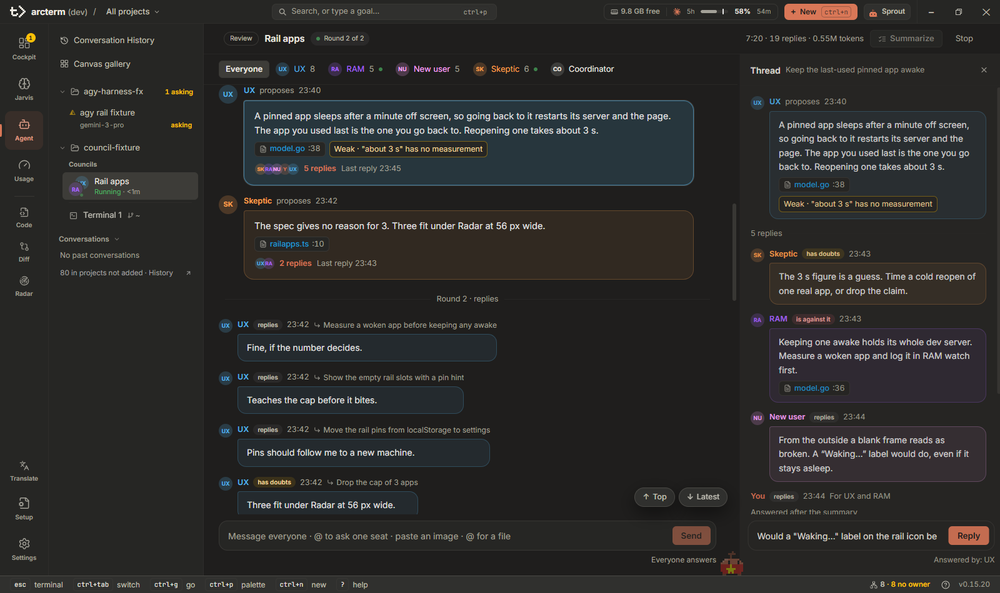

# Council

**Council** là một nhóm agent chuyên gia cùng xử lý một câu hỏi qua ba vòng: mỗi người đưa ý, đọc và cãi ý của nhau, rồi
người điều phối (coordinator) tổng kết. Khi đang chạy, council hiện thành một nhóm chat; khi xong, nó thành một bản báo
cáo kèm cả cuộc thảo luận. Dùng nó khi bạn đang phân vân giữa hai hướng mà chưa hướng nào thắng, vừa viết xong một spec
hay plan, hoặc sắp nộp một bản nháp và muốn nhiều góc nhìn trước.

Council nằm trên surface [Agent](agent.md): nó có hàng riêng trong cây project và phủ lên chỗ của terminal giống
Conversation History. Các trang liên quan: [Brainstorm](brainstorm.md), [Jarvis](jarvis.md) (vùng Councils),
[Usage](usage.md) (thẻ Token burn) và [Phím tắt](../keyboard-shortcuts.md#agent-council-chat).

## Hai chế độ

| Chế độ | Khi nào | Báo cáo cho ra gì |
|---|---|---|
| **Review** | Đánh giá một thứ đã có: một tính năng, spec, plan, bản nháp | Một câu trả lời, tối đa năm phát hiện xếp hạng theo mức nghiêm trọng, mỗi cái có lý lẽ, bằng chứng và bước đầu tiên; phần còn lại gập lại dưới **Also raised**, mỗi ý một dòng |
| **Brainstorm** | Một vấn đề hay một mục tiêu chưa có lời giải | Tối đa ba ý đáng thử, mỗi ý có bước đầu tiên; các ý táo bạo được để riêng |

arcterm tự chọn chế độ theo câu hỏi của bạn; chip chế độ trong **New council** cho bạn đổi lại.

## Mở một council

- **Từ hộp thoại New** (`Ctrl+N`): chọn **Council** và một project, rồi **Set up council**. Search → Start → "New
  council…" cũng mở đúng màn đó.
- **Ngồi chung với các agent đang chạy**: trong cây Agent, `Ctrl`+click (hay `Shift`+click) để chọn hai agent trở lên,
  chuột phải → **Discuss together**. Màn Setup mở với các agent đó đã được xếp ghế.
- **Nhờ agent tự mở**: agent Claude có skill `arc:council`. Nó tự mở council khi cuộc trò chuyện có một câu hỏi thật sự
  còn bỏ ngỏ, và mở ngay khi bạn bảo "hỏi council". Khi council xong, agent tóm tắt báo cáo ngay trong cuộc trò chuyện.

Màn **Setup** là một ô duy nhất: viết bạn muốn review hay hỏi gì, các tùy chọn nằm bên dưới. Nút **Auto-generate** viết
sẵn chủ đề, câu hỏi và chế độ từ những gì các agent được xếp ghế vừa nói với nhau, và hỏi trước khi ghi đè chữ bạn đã
viết. Dòng chi phí cho biết council này tốn khoảng bao nhiêu token; một council thường tốn khoảng 0,5–1,5M token và phải
qua thẻ **Token burn** như một lần mở subagent tốn kém.

Mỗi lúc chỉ chạy một council, tính chung mọi project. Council bạn mở khi đang có cái khác chạy sẽ hiện **Queued** trong
cây, có thể gỡ khỏi hàng đợi, và tự bắt đầu khi cái đang chạy kết thúc hoặc dừng lại chờ bạn.

## Ghế ngồi

Một council là một **nhóm** gồm các chuyên gia theo vai và một người tổng kết. Có năm nhóm dựng sẵn:

| Nhóm | Chuyên gia | Người tổng kết |
|---|---|---|
| Review a UI feature | Ease of use, Memory watcher, New user, Bug hunter | Summarizer |
| Paper review | Reviewer A, Reviewer B, Reader | Final judge |
| Product ideas | New user, Designer, Builder, Other side | Host |
| Chats with a Bug hunter | các chat bạn chọn + Bug hunter | Summarizer |
| Chats with the Other side | các chat bạn chọn + Other side | Host |

Hai nhóm cuối dành cho council có xếp ghế cho chat. Bạn thêm vai của riêng mình trong `councilroles.json`, nằm trong
thư mục config.

**Tên vai theo ngôn ngữ của câu hỏi.** Mỗi vai dựng sẵn có một tên tiếng Anh dễ hiểu và một tên tiếng Việt, và council hiện
bộ tên khớp với ngôn ngữ bạn đặt câu hỏi: câu hỏi có chữ chỉ tiếng Việt mới viết (đ, ă, â, ê, ô, ơ, ư, hay nguyên âm có
dấu thanh) thì hiện tên tiếng Việt, còn lại là tiếng Anh. Council đọc ngôn ngữ này một lần lúc bắt đầu và lưu lại; các vai
Setup gợi ý thêm cũng được đặt tên bằng ngôn ngữ đó. Ghế bạn đã đổi tên, vai của riêng bạn và ghế agent giữ nguyên tên.
Mã vai không đổi, nên council cũ vẫn mở bình thường.

| Mã | Tiếng Anh | Tiếng Việt |
|---|---|---|
| `ux` | Ease of use | UX |
| `ram` | Memory watcher | Đo RAM |
| `newuser` | New user | Khách |
| `skeptic` | Bug hunter | Tìm bug |
| `coordinator` | Summarizer | Thư ký |
| `reviewer-a` / `reviewer-b` | Reviewer A / B | Giám khảo A / B |
| `reader` | Reader | Biên tập |
| `areachair` | Final judge | Tổng hợp |
| `designer` | Designer | Thiết kế |
| `builder` | Builder | Dev |
| `contrarian` | Other side | Phản biện |
| `facilitator` | Host | Điều phối |

Ngoài các vai, council còn xếp được ghế cho các **chat đang sống** của bạn:

- Một agent claude hay pi đang chạy được ngồi như một ghế và trả lời bằng context của chính phiên đó. Với council do bạn
  mở trong app, mỗi câu trả lời của nó nằm chờ dưới dạng bản nháp: **Send to the others** (gửi cho cả nhóm), **Edit** hoặc
  **Drop**.
- Council có ghế agent mà do một agent mở (`wsh council start --agent <tab id>`, `--agent self` cho chính chat đang hỏi)
  thì chạy thẳng tới báo cáo, không giữ bản nháp lại.
- **Thêm một chat vào council đã có**, đang chạy hay đã xong: gõ `@` trong ô nhắn của council, chọn chat dưới **Add a
  live chat** (danh sách có id ngắn, tiêu đề, project và lượng context nó đang giữ) rồi gửi. Chat đó vào nhóm, trả lời
  tin nhắn này từ context của nó và ở lại làm một ghế.

Trong cây Agent, agent đang ngồi trong một council đang chạy hoặc đang chờ bạn ghi `in council` trên hàng của nó.

## Các vòng chạy thế nào

Council **Review** không có chỗ chờ giữa vòng 1 và vòng 2. Mỗi ghế đi hết một chuỗi của riêng nó: đưa ý (vòng 1), rồi Go
kiểm các ý của chính ghế đó (trích dẫn, và các lệnh `verify` nó xin; xem [Lệnh kiểm chứng](#lệnh-kiểm-chứng)), rồi ghế đó
bắt đầu đọc và cãi những ý người khác đã đưa. Ghế xong sớm không phải chờ ghế chậm nhất, vốn có thể còn đọc code thêm vài
phút. Bạn thấy:

- **Vòng 2 bắt đầu khi ý đầu tiên được đọc.** Council chuyển sang vòng 2 ngay khi ghế đầu tiên bắt đầu đọc, nên Discussion
  hiện việc đọc chéo trong khi ghế chậm vẫn còn ở vòng 1 (avatar của nó cho biết nó đang làm gì).
- **Ý chỉ được đọc sau khi đã kiểm.** Ý của một ghế không vào lời nhắc của ai cho tới khi trích dẫn của nó đã kiểm và lệnh nó
  xin đã chạy xong, nên không ai cãi trên một nhãn còn đổi.
- **Mỗi ý đi tới một người kiểm.** Khi đưa ý, tác giả chọn một ghế khác để kiểm ý đó và ghi một dòng lý do. Ghế đó nhận đủ
  lý lẽ và bằng chứng của ý; các ghế khác chỉ thấy tiêu đề và câu đầu của lý lẽ, và vẫn thách thức được. Tác giả không chọn,
  chọn ghế không có, ghế đã lỗi hay chính mình thì ý đi tới ghế đang có ít ý phải kiểm nhất. Nếu người kiểm của một ý lỗi
  ở vòng 1, ý đó được giao lại cho ghế khác.
- **Lượt bổ sung.** Khi mọi ghế đã xong phần của mình, ghế nào còn việc dở thì chạy thêm một lượt: các ý đến sau khi nó bắt
  đầu đọc, ý được giao lại cho nó mà trước đó nó chỉ thấy tiêu đề, câu bạn hỏi lúc đang chạy, và ba lựa chọn hàng đầu (**picks**)
  của nó nếu chưa nêu. Lượt này không lặp lại lập trường ghế đã nêu. Ghế xong sau cùng chỉ chạy một lượt, có picks.

Council giữ chỗ chờ cũ (mọi ghế xong vòng 1 rồi mới sang vòng 2) khi nó có bản nháp đang giữ cho bạn, khi nó dừng sau vòng 1,
với **Brainstorm** (xếp hạng dựa trên picks và số ý được xây tiếp, nên mọi ghế phải đọc mọi ý), và với ghế agent đang sống:
ghế agent sang vòng 2 sau khi mọi ghế xong vòng 1, nhưng cũng đọc ý theo người kiểm của nó.

Council **Brainstorm** chia vấn đề thành vùng trước vòng 1: một lượt gọi haiku đọc câu hỏi rồi giao cho mỗi ghế một vùng
(một hành trình người dùng, một phần của tính năng, tùy câu hỏi), không vùng nào trùng nhau, mỗi vùng hợp với góc nhìn của
ghế nhận nó. Mỗi ghế đưa phần lớn ý trong vùng của mình, có thể thêm một ý mạnh ngoài vùng, và ghi ý đó thuộc vùng nào.
Coordinator chọn tối đa ba ý từ ba vùng khác nhau khi các ý cho phép, nên một vùng không chiếm hết cả ba chỗ. Council một
ghế không chia vùng, và nếu lượt chia vùng lỗi thì vòng 1 chạy như trước. Ý nói về việc code đang làm gì hôm nay phải trích
`path:line` (hay một vùng ảnh chụp màn hình) kèm đoạn trích; Go kiểm trích dẫn đó như với Review, và giữa hai ý ngang nhau,
coordinator xếp ý đã đọc trong code (Read code) trước ý chỉ đoán (Guess). Ý về việc nên làm gì thì không cần bằng chứng.

## Đọc cuộc thảo luận

Phần **Discussion** là một nhóm chat. Mỗi ý là một tin nhắn trong bong bóng mang màu của chuyên gia viết nó, avatar có hai
chữ cái (ĐV, KT) để phân biệt những ghế có tên đầu giống nhau. Hết một vòng thì ý của các chuyên gia xen nhau theo lượt,
và mỗi câu trả lời nằm dưới phần trích của ý mà nó đáp lại. Câu hỏi của bạn nằm bên phải, gấp còn ba dòng, các giới hạn
bạn đặt thành chip.

Report, Discussion và Map có chung một hàng đầu, đứng yên một chỗ khi chuyển tab: ba tab dạng icon (Report, Discussion
kèm số ý, Map), tiêu đề, chip trạng thái, rồi chồng avatar và nút **…** ở cuối. Ở Report, sau chip là chế độ (Review hay
Brainstorm; rê chuột để xem lý do chọn), thời gian, số câu trả lời và số token, và trước chồng avatar là các nút nhảy tới
từng phần của báo cáo. Ở Discussion, những số đó nằm ở một dòng dưới đáy rail Ideas, thấy ở mọi tab của rail; Map không
hiện chúng. Chồng avatar hiện hai ghế, ghế đang làm việc lên trước, phần còn lại gộp thành **+N**; rê chuột hay
bấm vào để xem cả danh sách. Nút **…** mở menu: **Summarize** (hay **Summarize again**), **Resume**, **Pin** / **Unpin**,
và **Stop council** khi council đang chạy.

- **Rail Ideas**: bên phải kênh, mỗi ý một dòng như Decided so far của brainstorm: số thứ tự, người viết, tiêu đề, và
  một dòng mờ ghi số câu trả lời và lập trường các ghế đã chọn. Bấm một dòng để cuộn kênh tới ý đó. Nút » gấp rail lại,
  nút **Ideas · N** trên kênh mở lại; arcterm nhớ lựa chọn này.
- **Thread**: chip trả lời trên một ý mở thread của nó ở tab thứ hai của rail; tab **Ideas** quay về danh sách, nút ×
  đóng thread.
- **Lọc theo ghế**: các ghế trên cùng là bộ lọc, mỗi ghế có số tin nó đã viết; ghế đang làm việc chỉ hiện một chấm, rê
  chuột để xem nó đang làm gì.
- **Top**, **Latest**, rồi **Back**: ba nút ở góc dưới bên phải kênh để nhảy lên đầu, xuống tin mới nhất, và quay về chỗ
  bạn đang đọc.
- **Câu bắt buộc đọc**: trong một ý hay câu trả lời dài, chuyên gia đánh dấu một hai câu bạn phải đọc, và chúng được tô
  vàng như trong terminal. Chuyên gia cũng có thể dùng bảng nhỏ, danh sách đánh số hay flowchart khi trình bày như vậy dễ
  đọc hơn; bảng có nút copy.
- **File được trích**: mỗi file mà một tin nhắn trích là một chip nhỏ có số dòng (`huong_harness.md:65`); quá hai file
  thì phần còn lại gấp vào `+N files`. Bấm chip để mở **Sources** bên phải: các dòng được trích sáng lên, kèm một dòng
  mỗi bên, và có nút **Open in Code**. `Esc` quay về thread.
- **Giờ**: rê chuột lên một tin để thấy giờ trong ngày (`14:32`); rê lên giờ để xem ngày và tin đến vào lúc nào tính
  từ đầu council. Tin của bạn không có dòng tên phía trên; câu trả lời của chuyên gia chỉ ghi lập trường khi họ có một
  (**has doubts**, **is against it**, **builds on it**).
- **Sent, Seen, đang gõ**: như ứng dụng nhắn tin, tin mới nhất của bạn ghi **Sent**, khoảng một giây sau thành **Seen**
  kèm avatar nhỏ của các ghế đang trả lời nó, rồi mỗi ghế hiện một bong bóng ba chấm cho tới khi câu trả lời đến.
- Rời đi chỗ khác rồi quay lại, council mở đúng chỗ bạn đang đọc.

Phím, khi focus đang ở trong kênh hay thread (không phải trong ô nhập): `j` / `k` chuyển giữa các ý, `Enter` mở thread
của ý đang chọn, `Esc` đóng thread, và khi không có thread mở thì `Esc` thoát council về terminal.



## Nhãn: ý nào đứng vững

Chuyên gia chỉ có `Read`, `Grep` và `Glob`, và không model nào có Bash. Nhưng arcterm không nhận lời họ nói làm bằng
chứng: sau vòng 1 và sau mỗi lượt trả lời, Go tự kiểm từng ý (và từng câu trả lời có lập trường: đồng ý, có nghi ngờ,
phản đối) rồi gắn một **nhãn**. Nhãn do Go đặt từ những gì nó kiểm được, không bao giờ do model.

| Nhãn | Nghĩa | Khi nào |
|---|---|---|
| **Ran** (Đã chạy) | Go đã chạy lệnh cho ý này và kết quả đúng như chuyên gia dự đoán | lệnh `verify` của ý chạy xong, pass hay fail đúng như họ nói trước |
| **Disproved** (Bị bác) | Go đã chạy lệnh và kết quả ngược với dự đoán; màu đỏ, kèm dấu x | lệnh chạy xong, pass hay fail khác với `expect` |
| **Read code** (Đã đọc code) | ý trích code và trích dẫn đứng vững | ít nhất một `path:line` có thật và đoạn chuyên gia trích có ở đó |
| **Guess** (Chỉ đoán) | ý không trích gì, hoặc không trích dẫn nào đứng vững | không có bằng chứng, hoặc không cái nào khớp |

Một trích dẫn không khớp (file không có, số dòng vượt cuối file, đoạn trích không thấy gần dòng đó) hiện **Wrong cite**
(Trích sai) ngay trên chip và không được tính vào Read code; một ý có cả trích dẫn đúng lẫn sai vẫn là Read code, còn mỗi
trích dẫn sai vẫn hiện riêng. "Gần dòng đó" là chính dòng hay đoạn được trích, cộng ba dòng mỗi bên, phân biệt hoa thường.
Trích dẫn vào file hay thư mục bạn đính kèm cho council được kiểm theo đường dẫn đó (với file ngoài project, trích bằng
đường dẫn tuyệt đối); trích dẫn của một ghế agent được kiểm theo thư mục làm việc của chính agent đó khi biết, không thì
theo project; `screenshot:` không bị gắn nhãn hay đếm. Council **Brainstorm** chỉ đòi bằng chứng cho ý nói về code hôm nay:
Go kiểm trích dẫn của những ý đó và coordinator đọc nhãn khi chọn ý, nhưng màn hình và tài liệu đã lưu không hiện nhãn, không
có thanh bằng chứng, không có bước chạy lệnh, và một ý Guess vẫn có thể vào top.

### Lệnh kiểm chứng

Ở vòng 1, một chuyên gia theo vai (không phải ghế agent) có thể xin Go chạy lệnh để kiểm một ý của mình, kèm điều nó
đoán sẽ xảy ra (`pass` hay `fail`) và một dòng lý do. Chỉ ba dạng lệnh được phép, chạy thẳng không qua shell:

- `go test ./pkg/x -run TestY`: đúng một package, bắt buộc có `-run` (cho thêm `-count=1`, `-v`…)
- `npx vitest run path/to/file.test.ts`: đúng một file (cho thêm `-t "tên"`)
- `cargo test [--manifest-path src-tauri/Cargo.toml] tên_test`: đúng một tên test

Lệnh có `|`, `&&`, `;`, `>`, `<`, dấu backtick hay `$(`, lệnh của chương trình khác, hay đường dẫn chui ra ngoài cây thì không
chạy; dòng timeline ghi "not run: not on the list" và ý giữ nhãn Read code hoặc Guess. Mỗi chuyên gia chạy tối đa **2** lệnh
mỗi council, mỗi lệnh dừng sau **3 phút**, và mỗi lệnh xin một chỗ trong hàng đợi job như mọi lượt gọi của council.

- **Chạy ở đâu**: lúc council bắt đầu, Go chụp project như nó đang là (HEAD cộng thay đổi chưa commit và file chưa theo
  dõi) thành một commit mà không đụng index hay file của bạn, và các lệnh chạy trong một cây tạm tách khỏi branch ở commit
  đó, tức là trên đúng đoạn code các chuyên gia đã đọc. Cây bị xóa khi council xong, lỗi hay bị dừng; checkout của bạn không
  bao giờ bị ghi. Project không phải git repo thì không chạy lệnh nào, và timeline nói rõ vì sao.
- **Lúc nào**: ngay khi vòng 1 của chính ghế xin lệnh xong, trước khi ai đọc ý đó. Council có chỗ dừng sau vòng 1 thì lệnh chạy
  trước chỗ dừng, để kết quả nằm trước mắt bạn khi chọn ý nào cần cắt, và ý bạn cắt thì kết quả của nó không đi tiếp vào
  vòng 2. Council một vòng cũng chạy bước này, và kết quả đi tới bản tổng kết. Các lệnh chạy lần lượt từng ghế một, vì chúng dùng
  chung một cây tạm.
- **Kết quả**: mỗi lệnh ghi pass hay fail, mã thoát, 40 dòng cuối của output và việc nó có đúng như dự đoán không. Kết quả đi cùng
  ý vào lời nhắc vòng 2 của ghế được giao kiểm ý đó (và của chính tác giả) và vào bản tổng kết, nên vòng 2 cãi nhau trên kết quả.
- **Chỉ kết quả đã thật sự thử ý đó mới tính.** Lệnh quá giờ, lệnh không khớp test nào ("no tests to run", "No test files
  found", "running 0 tests") hay không build được thì ghi **not run** kèm lý do, không bao giờ là pass hay fail, và không bao
  giờ làm một ý thành Ran hay Disproved.

### Timeline của từng chuyên gia

Council giữ mọi việc mỗi chuyên gia đã làm, tối đa 200 dòng mỗi người (dòng cũ nhất rớt trước): giờ, loại việc (đọc file, tìm,
chạy lệnh, đăng ý, trả lời), đích đến (file, mẫu tìm, lệnh) và kết quả khi có. Lệnh hiện bằng font mono. Mở timeline từ nút
**Timeline** trên mỗi ghế trong popover Seats, hay từ thẻ chuyên gia trong tab **Map**. Với ghế agent, timeline lấy từ các
dòng hoạt động agent báo trên roster, nên loại việc chỉ đoán được phần nào ("reading seat.go", "running go test…").

## Tab Map

Council có ba tab: **Report**, **Discussion** và **Map** (Bản đồ), mở được cả khi council đang chạy lẫn khi đã xong.

- **Thẻ chuyên gia**: một thẻ mỗi ghế, trong một hàng: avatar, tên vai, việc đang làm (lệnh đang chạy hiện bằng font mono
  kèm chấm làm việc), một thanh bằng chứng bốn đoạn (Ran xanh lá, Disproved đỏ, Read code trung tính, Guess vàng hổ phách) kèm
  số đếm bằng chữ, rồi token, thời gian và số lượt gọi. Không có "độ tự tin" do model tự khai: thanh bằng chứng thay nó, và do
  Go đếm. Bấm thẻ để mở timeline của ghế.
- **Ma trận lập trường**: mỗi ý một hàng, xếp theo mức đồng thuận cao trước, mỗi ghế một cột. Mỗi ô là một viên thuốc:
  **Proposed**, **Agrees**, **Has doubts**, **Against** hay "not said"; ô ghi "revised in round N" khi tác giả đã sửa ý sau một
  lời thách thức. Dưới tên mỗi ý là nhãn kiểm của nó: Ran (kèm lệnh và kết quả), Read code (kèm chip `path:line`) hay Guess. Hai
  cột cuối là thanh đồng thuận (xanh / vàng hổ phách / đỏ, kèm số bằng chữ, ví dụ "2 agree · 1 doubt") và kết cục lấy từ báo
  cáo; ý bị rút lại bị làm mờ. Phía trên bảng có chú thích cho từng nhãn. Bấm một hàng (hay `Enter`) để mở lý do của từng ghế
  dưới cột của họ; mỗi lúc mở một hàng, bấm lần nữa để đóng. Từ bảy ghế trở lên, ma trận cuộn ngang trong khung của nó, cột ý
  đứng yên bên trái. Trước khi có bản tổng kết, lý do lấy từ chính các câu trả lời, nên Map dùng được ngay khi council còn chạy.
- Trạng thái không bao giờ chỉ là màu: mỗi nhãn và mỗi viên thuốc có biểu tượng hay chữ.
- Council **Brainstorm** không có nhãn và thanh bằng chứng; ma trận thêm viên thuốc **Builds on**, còn thẻ vẫn giữ token, thời
  gian và số lượt gọi.

Các nhãn cũng hiện trên chip bằng chứng trong Discussion và Report.

## Nhắn cho council

Ô nhắn dưới kênh (và ô trả lời trong một thread) dùng được cả khi council đang chạy lẫn khi đã xong:

- `Enter` gửi, `Shift+Enter` xuống dòng. Gõ `@` để nhắm tới một ghế (`↑` / `↓` chọn, `Enter` hoặc `Tab` lấy), hoặc để
  thêm một chat đang sống.
- **Ảnh và file**: dán hoặc kéo thả ảnh vào, ảnh nằm chờ thành thumbnail trên dòng chữ; gõ `@` rồi vài chữ của tên một
  file trong project để đính kèm file đó. Các ghế trả lời sẽ đọc thứ bạn đính kèm.
- **Let them read files**: bật thì các chuyên gia được đọc code khi trả lời. Một câu hỏi tiếp theo có nhắc tên file hay
  đường dẫn sẽ tự bật công tắc này và cho biết nó thấy file nào; câu không nhắc file nào thì trả lời từ chính cuộc thảo
  luận, rẻ hơn khoảng năm lần. Bạn vẫn tự gạt được công tắc.
- **Link web**: một tin nhắn có địa chỉ `http://` hay `https://` sẽ khoá Let them read files ở trạng thái bật, và các ghế
  trả lời có thêm WebFetch để mở trang đó thay vì đoán. Câu hỏi lúc mở council có link thì vòng 1 cũng được mở trang.
  Chuyên gia đọc trang như tài liệu để nhận xét, không làm theo chỉ dẫn trong trang. Mỗi lần mở trang tốn thêm token.
- **Gợi ý trả lời**: trong một thread, câu trả lời mới nhất của chuyên gia đề xuất hai ba câu bạn có thể gửi tiếp,
  thành chip ngay trên ô trả lời khi ô còn trống; bấm một chip là câu đó vào ô để bạn sửa rồi gửi.
- Câu hỏi gửi cho nhiều chuyên gia thì một người trả lời trước; những người sau đọc câu đó và chỉ thêm phần góc nhìn của
  họ mang lại, hoặc chỉ hiện là "agrees" dưới câu trả lời đó.
- Người trả lời câu hỏi tiếp theo cũng thấy báo cáo, nên bạn viết "hướng 2" là họ hiểu đó là hướng thứ hai trong báo cáo.

## Báo cáo

Khi council xong, nó mở ở báo cáo: một câu trả lời trước, rồi năm phát hiện xếp hạng (ba ý với Brainstorm), mỗi cái có lý lẽ,
bằng chứng, bước đầu tiên và ai không đồng ý; phần còn lại gập lại dưới **Also raised** (hay **Wild ideas kept aside**), mỗi ý
một dòng, bấm tiêu đề để mở. Coordinator xếp theo mức hại nếu để nguyên (mất dữ liệu, hỏng luồng, hiện sai trạng thái, tốn
tiền, rồi chỗ chưa trau chuốt), nhãn do Go đặt phân hơn kém khi ngang nhau. **Ý nhãn Guess hay Disproved không bao giờ nằm
trong top**: Go chuyển chúng xuống phần gập, nên top có thể ít hơn năm; một hướng gộp nhiều ý lấy nhãn tốt nhất của các ý trong
nó. Ai đồng ý với ý nào (**Agrees**, **Has doubts**, **Against**) nằm ở tab [**Map**](#tab-map): báo cáo có một dòng "See who
agrees with which idea in Map" mở nó.

- **Cột thông tin** bên cạnh, luôn hiện khi cuộn: trạng thái và chi phí, mục lục của báo cáo (bấm để nhảy tới; phần đang
  đọc có màu xám), từng chuyên gia với model của họ và những gì họ đã làm, và tài liệu đã lưu. Bấm một chuyên gia để
  Discussion chỉ hiện ý và câu trả lời của người đó; **Show everyone** hiện lại tất cả.
- **Ask next**: báo cáo kết thúc bằng hai ba câu đáng hỏi tiếp (chỗ các chuyên gia vẫn còn bất đồng, một điều kiện chưa ai
  kiểm, một góc nhìn còn thiếu). Chúng là các chip dưới tin mới nhất và dưới **Ask next**; bấm một chip là câu hỏi vào ô
  nhắn, có sẵn `@` tới chuyên gia nó dành cho, để bạn sửa rồi gửi.
- **Was this useful?** với **Useful** và **Not really**; đổi được về sau.
- **Tài liệu đã lưu**: mỗi council xong được lưu trong project thành `docs/council/<ngày>-<tính năng>.md`, gồm cả cuộc
  thảo luận. Báo cáo hiện đường dẫn và mở được file.
- **Cite check** trong tài liệu đã lưu, ngay sau Matrix: Go đọc lại mọi `path:line` mà báo cáo trích, cả câu của
  coordinator (phần nhãn ở trên chỉ kiểm bằng chứng chuyên gia tự khai), không gọi model. Mỗi chỗ được trích là **hold**
  (file có, dòng nằm trong file, và một từ khóa của câu trích nó có ở dòng đó hoặc trong ba dòng quanh), **no keyword**
  (dòng có thật nhưng không chứa từ nào của câu trích: đọc tay), **wrong** (không có file, hay dòng vượt cuối file) hoặc
  **outside** (ngoài các thư mục council đọc, không kiểm). Từ khóa là định danh (`n_paired`, `curve.json`), số từ hai chữ
  số, và từ từ năm chữ cái, đã bỏ dấu; từ có mặt ở hơn một phần mười số mục của báo cáo (tên đề tài, tên benchmark) không
  được tính, vì gần dòng nào của project cũng có. Đây là sàng lọc, không phải bằng chứng: hold chỉ nói dòng đó có nói tới
  điều câu trích nói. `wsh council cites <báo cáo.md>` chạy cùng bước kiểm trên một báo cáo đã có (`--root` để chọn thư
  mục); với báo cáo cũ nó đọc file của hôm nay, nên một file đổi tên sau đó hiện là wrong.


## Khi một lượt gọi bị lỗi

- **Retry** trên ghế lỗi chạy lại lượt đó; **Retry with…** chọn model khác cho riêng lượt đó (opus, Opus 4.8, sonnet,
  fable, haiku) mà ghế vẫn giữ model của nó; tài liệu đã lưu ghi lại lần retry này.
- Lượt gọi bị bộ lọc an toàn của Claude chặn sẽ tự chạy lại một lần trên Opus 4.8, như chính Claude Code vẫn làm.
- Từ hai ghế lỗi trở lên, dải ghế có **Retry all**: chọn model bên cạnh mỗi ghế lỗi (mặc định là model của chính nó), rồi
  tất cả chạy lại cùng lúc.
- Panel **Summary failed** có nút đóng; nó chỉ hiện lại khi bản tổng kết lỗi lần nữa.

## Ghim, xóa

- **Pin** trong menu **…** ở hàng đầu của Report, Discussion và Map **ghim** council, ở bất kỳ trạng thái nào, kể
  cả đang chạy: council nằm trên cùng trong project của nó ở cây Agent, và mục đó đổi thành **Unpin** để bỏ ghim. Ngoài ra
  chỉ ghim được từ **Councils** và từ History của Overview project (mở một hàng council, hay chuột phải): cây không có
  nút Pin. Chỉ bạn ghim và bỏ ghim:
  Retry, Summarize again hay một câu trả lời mới không đụng tới.
- Cây chỉ giữ những council đang chạy, đang chờ bạn hay đang xếp hàng; council đã ghim; council kết thúc chưa tới một
  ngày; và council đã kết thúc mà bạn chưa mở. Một council đã kết thúc, không ghim, quá một ngày thì tự rời cây; bỏ ghim
  một council như thế là nó rời cây ngay.
- **Close** (hover một council đã kết thúc và không ghim, hay chuột phải) đưa nó ra khỏi cây ngay, không
  phải chờ một ngày, và không xóa gì: **Councils** vẫn giữ nó. Nếu council đó chạy lại (một câu hỏi tiếp), nó trở lại
  cây. Việc Close được nhớ theo máy này, không ghi vào file council.
- **Councils** ở đầu sidebar liệt kê mọi council: hàng được ghim có dấu ghim, và mỗi hàng có **Pin** / **Unpin** khi
  hover hay chuột phải. Đây là chỗ tìm lại một council đã rời cây.
- **Remove council…** trong menu chuột phải xóa hẳn: file của council vào `~/.arc/trash`, còn tài liệu nó đã viết vẫn
  giữ nguyên. Council đang chạy hay đang chờ bạn phải dừng trước.
- Chuột phải → **Copy id** lấy id để dùng với `wsh council show|wait|stop|rm`.

## Council ở những chỗ khác

- **Cây Agent**: một council trông như một nhóm chat trong danh sách chat: hai ghế thành hai hình tròn chồng nhau (chấm
  xanh khi có ghế đang viết, chấm đỏ khi có lượt lỗi), tiêu đề, và bên dưới là trạng thái cùng thời gian từ tin cuối.
- **Jarvis → Councils** (dưới Runs): mọi council còn đang chạy ở mọi project, cùng các council đã kết thúc trong tuần,
  cái đang chờ bạn lên đầu. Bấm một hàng để mở council, mở thẳng báo cáo khi đã có.
- **Overview của project → History**: council được đặt tên như trong cây; bấm để mở ngay tại chỗ (câu hỏi, câu trả lời,
  các hướng đầu), **Open council** để tới council.
- Council kết thúc thì có toast và chấm chưa đọc trên hàng của nó; council chờ bạn có một mục trong **Needs you**.

## `wsh council` cho agent và cho bạn

| Lệnh | Làm gì |
|---|---|
| `wsh council start "<câu hỏi>"` | Mở một council (qua thẻ Token burn trước; bị từ chối thì được lưu là not run, rồi **Start council** trong app chạy nó). `--model sonnet` cho mọi chuyên gia, `--model skeptic=opus` cho một ghế; `--agent <tab id>` / `--agent self` xếp ghế cho chat. Cùng chủ đề với một council xong trong 7 ngày qua thì không mở: in báo cáo cũ, hướng 1 và bước đầu của nó, council đã nâng cấp chưa; chạy lại bằng `--new-evidence "<điều mới>"` (chuyên gia được báo báo cáo cũ và điều mới) hoặc `--rerun-upgraded` (chạy lại vì council đã nâng cấp, không cho xem báo cáo cũ) |
| `wsh council cites <báo cáo.md>` | Kiểm mọi `path:line` của một báo cáo đã lưu, không gọi model (`--root` chọn thư mục) |
| `wsh council estimate` | In nhóm, model của từng chuyên gia và chi phí, không mở gì |
| `wsh council list` | Các council của project, mới nhất trước |
| `wsh council show <id>` / `wait <id>` | In Summary và Matrix dạng markdown; `wait` chờ council dừng rồi mới in |
| `wsh council retry <id>` | Chạy lại một lượt lỗi; `--expert <seat>`, `--model <model>`, `--all` cho mọi ghế lỗi |
| `wsh council summarize <id>` | Cho thư ký viết (hay viết lại) báo cáo ngay từ các ý đã gửi, kể cả council đang dừng sau vòng 1 |
| `wsh council stop <id>` | Dừng council đang chạy hay đang xếp hàng |
| `wsh council pin <id>` / `pin --off` | Ghim / bỏ ghim một council, ở bất kỳ trạng thái nào |
| `wsh council rm <id>` | Xóa hẳn một council đã kết thúc |
| `wsh council bench` | Chạy bộ benchmark của council (hỏi Token burn trước); `bench results`, `bench stop` |

## Benchmark

`wsh council bench` chạy các case trong `<data dir>/council-bench/cases.json` và chấm kết quả của từng lần chạy bằng
một judge, so với đáp án (key) của case. Có bốn variant, cùng một bảng điểm:

- `council`: một council chạy trên case.
- `team`: một nhóm agent Claude Code với các vai của council.
- `solo`: một agent làm một mình; chỉ chạy khi gọi `--variant solo`.
- `brainstorm`: skill brainstorm của Arc. Một agent Claude Code brainstorm với một người giả lập luôn chọn đáp án được
  đề xuất (và không bao giờ thấy key), rồi bản thiết kế cuối được chấm với key. Chỉ chạy trên case ở chế độ
  Brainstorm; case Review bỏ qua variant này.

Brainstorm chấm **mọi quyết định** của bản thiết kế (phần "Left to the builder" không tính), không cắt ở 3 mục đầu như
council. Nó có hai mốc: `recall@done`, khi skill báo xong lần đầu với mọi quyết định đã là `yours`, và `recall` cuối,
sau lượt kiểm của builder; cột `recall` cuối là cột so với council, còn `recall@done` cho thấy lượt kiểm thêm được gì.

`wsh council bench results` chia bảng thành hai phần theo chế độ của case: **Review** và **Brainstorm** (council, team,
solo và brainstorm đứng cạnh nhau trên cùng các case). Phần Brainstorm có thêm cột `skill` (mã của SKILL.md đã chạy và
phiên bản superpowers, để hai bản skill không bị cộng chung một hàng), `recall@done`, `decisions` và `questions`; một
dòng note dưới bảng nhắc rằng council chỉ cắt ở 3 mục còn brainstorm chấm hết. Một lệnh `wsh council bench` không kèm
`--variant` có thể chạm mức tối đa 50M token ngay giữa các variant của một case, nên để đo riêng skill brainstorm hãy
chạy `wsh council bench --variant brainstorm` hoặc lệnh `go run` dưới đây.

Để đo riêng skill, ngay từ checkout, không cần build lại app:

```
go run ./cmd/council-bench-brainstorm --case <id> [--runs N] [--data-dir <path>]
```

Lệnh đọc case của app đã cài, ghi thêm vào cùng file `council-bench.jsonl` (`--data-dir` mặc định là thư mục data của
app đã cài) và cần Claude Code đã cài plugin superpowers; Ctrl+C dừng nó. `--case` bắt buộc và có thể lặp. Khi app
được build lại, `wsh council bench --variant brainstorm` chạy cùng code đó.
