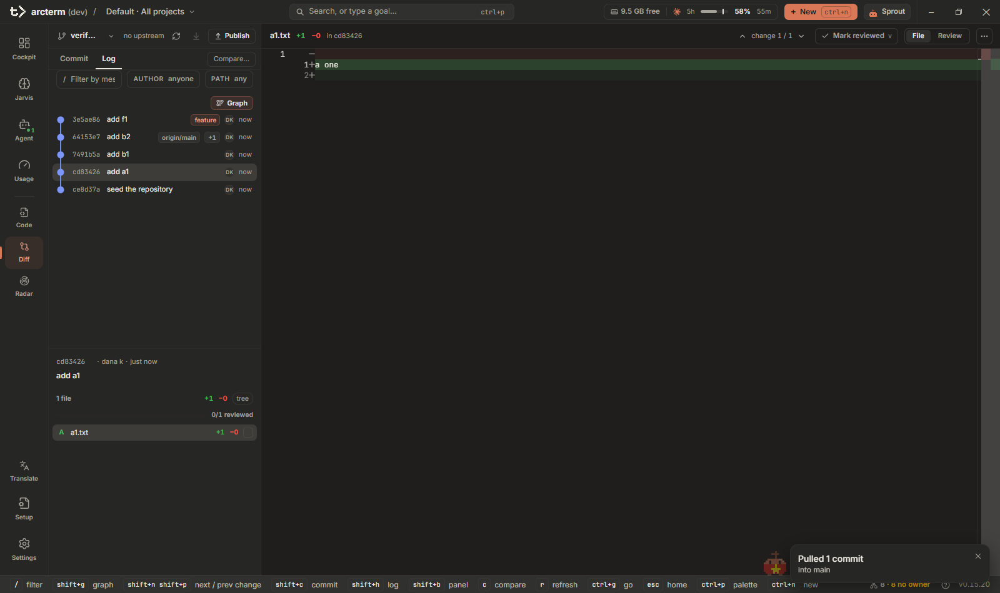
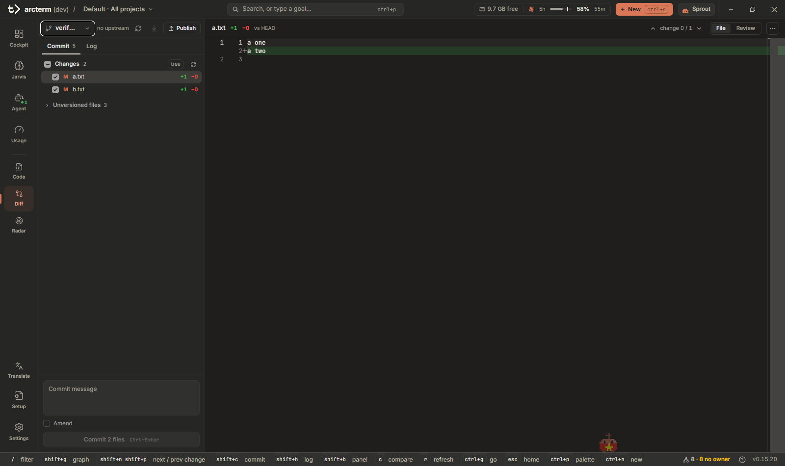

# Diff

**Diff** là nơi review Git của arcterm: chọn một repository, đi qua từng commit, đọc thay đổi của từng file, đánh dấu
file đã review, để lại comment theo dòng rồi gửi cả loạt cho agent trong một tin nhắn. Từ 0.15.9, Diff cũng **commit và
sync** được: commit những file đã tick, rồi Fetch, Pull, Push nhánh với upstream của nó.

Nhãn trên giao diện là **Diff**, còn khóa nội bộ của surface là `files` (ví dụ `wsh ui reveal surface:files`, hoặc
`Ctrl+G` `f`).

Các trang liên quan: [Agent](agent.md) (tab Changes và File trên rail của agent), [Code](code.md) (sửa file, Blame,
diff với `HEAD` hay base của branch), [Cockpit](cockpit.md), [Orchestrator](orchestrator.md) (diff của một run).

## Mở Diff

| Cách | Kết quả |
|---|---|
| Nav rail → **Diff** | Mục thứ hai trong nhóm công cụ (Code, Diff, Radar) |
| `Ctrl+6` (`Cmd+6` trên Mac) | Nhảy theo vị trí trong nav rail |
| `Ctrl+G` rồi `f` | Chuỗi "go to" |

Khi Diff mở mà chưa chọn nguồn nào và cũng không có agent nào đang được focus, nó lấy agent đầu tiên trong roster; nếu
chỉ có project thì bạn chọn nguồn trong dropdown. Không có agent lẫn project thì bạn thấy màn "No changes to show" với
nút **New agent**.

Surface này bị gỡ khỏi màn hình mỗi khi bạn chuyển đi, nhưng vị trí cuộn, bộ lọc, commit và file đang chọn được giữ lại.
Rời đi hơn hai phút rồi quay lại thì một banner **Back where you left off** cho biết đã khôi phục những gì, có nút **Start
from the top**, và tự tắt sau 6 giây.

### Những chỗ khác trong app mở Diff sẵn

| Từ đâu | Thao tác | Diff mở ở |
|---|---|---|
| Thẻ agent trong Cockpit | Menu của thẻ → **Review changes** (chỉ có khi agent có thay đổi) | Agent đó, range **Since session start** |
| Rail của agent → **Files changed** hay tab **Changes** → bấm một file | Mở ngay | Tab File cạnh terminal, dạng diff (chưa phải surface Diff) |
| Tab File của agent | Nút **Open in Diff** | Agent đó, đúng file đó |
| Rail của agent → **View diff** | Bấm nút | Agent đó; với công tắc Branch thì là phép so sánh cả branch với `main` |
| Hộp thoại của Office | **Diff** trong menu ▶ | Các file agent đó đã đổi |
| Hàng của run trong cây Agent | Chuột phải → **Open the diff** | Run đó, range **This run** |
| Run sheet, màn hoàn tất run | Một file trong danh sách, hoặc **Open repository diff** / **Open the diff** | Run đó, range **This run**, có thể kèm file |
| Transcript của một session đã kết thúc | Nút **Review** ở thanh files | Project của session, range **Working tree** |

Khi đi vào từ một file cụ thể, việc chọn file đó chỉ có tác dụng một lần: các lần quay lại sau không kéo bạn về file ấy
nữa.

## Bố cục

Bên trái là **một panel**, bên phải là **diff rộng**.

- **Thanh trên của panel**: dropdown **nguồn** (biểu tượng branch, tên project hoặc agent, tên nhánh) và cụm **sync**
  (số commit đi trước / sau upstream, cùng các nút Fetch, Pull, Push).
- **Hai tab**: **Commit** (`Shift+C`) để tick file và commit, **Log** (`Shift+H`) để xem lịch sử.
- **Diff** bên phải: header một dòng, rồi một trình diff Monaco (chế độ **File**) hoặc danh sách mọi file để comment
  (chế độ **Review**).

`Shift+B` ẩn hoặc hiện panel. Ở cửa sổ hẹp panel bắt đầu ở trạng thái ẩn, và lựa chọn của bạn được nhớ. Khi panel ẩn,
header của diff mang luôn các lối vào của panel (nguồn, số đi trước / sau, hai tab) cùng nút chuyển file trước / sau.



## Chọn nguồn và range

**Dropdown nguồn** là nơi duy nhất chọn repository đang đọc (**Choose a project, worktree or agent**). Nó mở một cây gồm
mọi project đã đăng ký, trong mỗi project là checkout chính rồi các linked worktree theo thứ tự của `git worktree list`:

- **Dòng worktree** ghi nhánh (hoặc `detached <commit>`), số file chưa commit, và `↑` / `↓` số commit đi trước / sau
  nhánh của checkout chính. Worktree đọc lỗi mang dấu cảnh báo; project đọc lỗi ghi "Couldn't read worktrees" nhưng
  checkout chính của nó vẫn chọn được.
- **Dòng agent** nằm dưới worktree mà agent đang chạy trong đó; agent có thư mục ngoài mọi worktree đã liệt kê nằm ở
  nhóm **Other agents** cuối cây. Chọn một agent cũng chuyển focus của cockpit sang agent đó.
- **Ô lọc** ở đầu (**Filter worktrees and agents**) lọc theo tên project, nhánh, đường dẫn và tên agent.

Khi nguồn là một agent, Diff đi theo focus của cockpit: đổi agent được chọn ở nơi khác thì Diff đổi theo. Chọn hẳn một
project hay worktree, hoặc đi vào từ một run, thì focus không kéo Diff đi nữa. Run không có trong cây: bạn chỉ vào đó
từ chứng cứ của một run (bảng trên).

**Range** là khoảng lịch sử đang xem. Nó do cách bạn đi vào quyết định, không có dải chip riêng:

| Range | Khi nào | Nghĩa |
|---|---|---|
| **Working tree** | Mặc định | Công việc chưa commit so với `HEAD` |
| **Since session start** | Nguồn là agent | Worktree so với commit đang là `HEAD` lúc session của agent bắt đầu |
| **This run** | Đi vào từ một run | Từ base commit của run đến `HEAD` (hàng đầu ghi **Run changes**) |
| **Compare** | Bấm **Compare…** trong tab Log, hoặc `c` | Hai ref so với nhau, xem [So sánh hai ref](#so-sánh-hai-ref) |

## Tab Log: lịch sử

Nửa trên của tab là đồ thị lịch sử, nửa dưới là commit đang chọn và danh sách file của nó; kéo vạch ngăn để đổi tỉ lệ.

**Lịch sử**, commit mới nhất ở trên. Mỗi dòng có hash ngắn, chip ref (thừa thì gộp thành `+2`), subject, một vòng tròn
mang chữ cái đầu tên tác giả, và tuổi; rê chuột để xem tên, email và ngày chính xác.

- **Dòng đầu là working tree** khi có file thay đổi: hash vẽ thành vòng nét đứt, thời gian là `now`, nhãn theo range
  (**Uncommitted changes**, **Since session start** hay **Run changes**).
- **Dải phân cách** đánh dấu điểm neo của range (`session start` hoặc `run base`); các commit trước điểm neo bị làm mờ.
- **Graph** vẽ tối đa 7 lane, lane thừa gộp vào một cột xám. `Shift+G` bật hoặc tắt nó. Graph tự tắt khi có bộ lọc.
- Lịch sử nạp 50 commit mỗi trang và nạp thêm khi bạn cuộn tới gần đáy. Lần đọc đầu kéo dài quá 10 giây thì cột báo
  "Still reading history" kèm **Retry**.

**Lọc lịch sử** (`/`): ô "Filter by message" (`git log --grep`), chip **author** (`--author`), chip **path** (`-- <path>`).
Gõ có độ trễ 250 ms. Khi có lọc, tiêu đề ghi số commit khớp và có **Clear filters** (`Esc`).

**Commit đang chọn**: hash (có **Copy hash**), tuổi, subject, tác giả, chip ref. Với dòng working tree thì ghi đo từ đâu,
ví dụ `On main, measured from 3e1f31e`. Bên dưới là số file với `+thêm −xóa` rồi danh sách file; **tree** / **flat**
chuyển giữa nhóm theo thư mục và danh sách phẳng.

- Chọn một commit là file đầu tiên của nó mở luôn; `↓` / `↑` trong danh sách file mở file kế / trước mà không cần `Enter`.
- File git không đếm được theo dòng ghi `bin` (nhị phân), `repo` (repository lồng bên trong) hoặc `dirty` (submodule có
  thay đổi bên trong) thay cho `+0 −0`. Commit đang nạp file thì ghi "Reading this commit's files…", đọc lỗi thì có
  **Retry**, và commit thật sự không đổi file nào thì ghi "This commit changes no files".

Khi Diff đang hiện, danh sách thay đổi được đọc lại mỗi 10 giây, và một commit mới (agent commit trong worktree đang xem)
làm lịch sử tự đọc lại một lần. `r` đọc lại tất cả ngay.

## Tab Commit: commit và sync

Tab **Commit** (`Shift+C`, focus vào ô message) liệt kê các file trong working tree, mỗi file một ô tick: nhóm
**Changes** được tick sẵn, nhóm **Unversioned files** thì không.

1. Bấm một hàng (hoặc `↓` / `↑`) để mở diff của file đó so với `HEAD`; `Space` để tick hay bỏ tick.
2. Viết message, rồi bấm **Commit** hoặc `Ctrl+Enter`. **Chỉ những file đã tick được commit**, nên những gì một phiên
   khác đã stage vẫn ở nguyên trong stage.
3. **Amend** nạp message của commit cuối để viết lại nó; nút này tắt khi commit đó đã được push ("Already pushed: amending
   would need a force push").

Một hook chặn commit thì panel ghi "A hook stopped the commit" kèm output của hook; commit lỗi vì lý do khác thì ghi "The
commit did not go through".



**Sync**: cụm nút ở thanh trên làm việc trên nhánh hiện tại so với upstream của nó, kèm số `↑ đi trước ↓ đi sau`
(chuyển màu hổ phách khi nhánh vừa đi trước vừa đi sau, tức là đã phân kỳ).

| Nút | Việc nó làm |
|---|---|
| **Fetch** | Cập nhật các ref remote-tracking |
| **Pull** | Chỉ fast-forward. Có agent đang làm việc trong thư mục đó thì hỏi trước (**Confirm pull**), kèm tên các agent mà pull sẽ đổi file dưới chân |
| **Push** | Không bao giờ force. Nhánh chưa có upstream thì nút là **Publish** |

Git từ chối một lần Pull hay Push thì một dải dưới thanh trên giải thích lý do (có **Open a terminal here** để bạn tự xử
lý), và repository không bị đổi gì.

## Đọc diff của một file

Một trình diff Monaco dùng cho mọi trạng thái; chúng chỉ khác ở hai ref được nạp vào hai phía:

| Đang chọn | Bên trái | Bên phải |
|---|---|---|
| Dòng working tree | Ref gốc của range (`HEAD`, commit lúc session bắt đầu, base của run) | File trên đĩa, nên sửa đổi đang diễn ra hiện ngay |
| Một commit | Cha đầu tiên (`<hash>^`) | Commit |
| **All changes** của Compare | Merge base hoặc base, tùy dạng so sánh | `head` |

**Header** là một dòng: đường dẫn (thư mục mờ, tên file đậm) và nó được đo so với gì, bộ chuyển thay đổi ▲ / ▼ kèm
`change 2/5` (`Shift+P` / `Shift+N`), **Mark reviewed**, công tắc **File** / **Review**, và menu **⋯** (**View
options**) chứa:

- **Split** / **Unified** (`Shift+D`), chỉ có khi pane đủ rộng.
- **Hide whitespace** (`Shift+W`).
- **Wrap** (`Alt+Z`): mọi file mặc định đã bọc dòng; lựa chọn này theo từng file và dùng chung với Code và tab File của
  agent.

Các vùng không đổi được gập lại, chỉ giữ 3 dòng ngữ cảnh quanh mỗi thay đổi; bấm dải gập để mở thêm.

**Khi không có gì để vẽ**, pane nói rõ lý do:

| Trạng thái | Câu hiện ra |
|---|---|
| Chưa chọn file | "Pick a file to see its changes" |
| Compare không có khác biệt file | "Nothing to compare" |
| Một phía quá 2 MB | "Too large to show here": mở file trong Code để đọc |
| File nhị phân (chế độ File) | "Binary file" |
| Nội dung giống nhau | "Contents unchanged": chỉ đổi tên hoặc mode của file |

File chưa được git theo dõi không có bản `HEAD`, nên hiện như file toàn dòng thêm.

## Đánh dấu file đã review

Đây là cách đi qua một commit hay một branch lớn mà không đọc sót file nào.

- `v` (hoặc **Mark reviewed** trên header) đánh dấu file đang mở là đã review rồi mở file chưa review kế tiếp. Nhấn `v`
  lần nữa trên một file đã đánh dấu thì bỏ dấu.
- Mỗi file trong danh sách có dấu tick ở đầu bên phải; một thư mục có tick để đánh dấu, hay bỏ đánh dấu, mọi file trong
  nó.
- Dưới dòng đếm file có thanh **n/m reviewed** (đổi thành **all N reviewed** khi xong).
- Một file thay đổi sau khi bạn đã review sẽ thành **stale** ("Changed since you reviewed it"), không còn tính là đã
  review.

Dấu được nhớ theo từng commit hay từng range, qua cả lần khởi động lại app.

## Review: comment theo dòng và gửi cho agent

Đây là cách trả lời agent bằng đúng dòng code mà bạn có ý kiến, thay vì mô tả bằng lời.

Khi chọn dòng working tree hoặc một commit (không phải Compare), công tắc **Review** thay trình diff bằng một danh sách
cuộn: mọi file thay đổi xếp chồng nhau, mỗi file một khối diff unified với số dòng cũ và mới. Đầu pane ghi "Every
uncommitted change" hoặc "Every file in this commit".

- Bấm tên file trong danh sách sẽ cuộn Review tới file đó; bấm tiêu đề một file trong Review để gập / mở nó.
- Đoạn không đổi dài gập thành `⋯ N unchanged lines`; bấm để mở.
- **Ảnh** (PNG, JPG, GIF, WebP) hiện bản trước và sau cạnh nhau (**Before** | **After**) trên nền ô cờ, kèm kích thước
  pixel và dung lượng file của mỗi bản.
- Review luôn bọc dòng, và tự đọc lại khi cây làm việc đổi mà không làm trắng màn hình.

### Làm thế nào để comment một dòng

1. Chọn **Review**.
2. Rê chuột vào một dòng, bấm nút `+` ở mép phải dòng đó.
3. Gõ vào ô "Leave a comment".
4. Bấm **Add Comment** hoặc `Ctrl+Enter`. `Esc` hoặc **Cancel** bỏ ô đó.

Để comment nhiều dòng: bấm `+` rồi **shift-click** một `+` khác trong cùng file, hoặc nhấn `+` và kéo qua các dòng. Một
khoảng không bắc qua hai phía được (dòng đã xóa thuộc phía cũ). Comment trên dòng đã xóa được ghi là `removed line`.

Mỗi comment hiện thành thẻ đánh số dưới dòng cuối của khoảng; bấm vào lời ghi chú để sửa, × để xóa. Mỗi lúc chỉ mở một ô
comment, và ô đang có chữ thì không bị mất. Comment được giữ trong bộ nhớ theo repository: còn nguyên khi bạn chuyển
surface, nhưng mất khi khởi động lại app.

### Khay gửi comment

Khay dán ở đáy pane, ở cả hai chế độ, ghi có bao nhiêu comment ("3 comments on 2 files") và có một nút gửi
(`Ctrl+Enter`). Một lần gửi đưa toàn bộ comment tới agent trong một tin nhắn.

| Tình huống | Nút | Việc xảy ra |
|---|---|---|
| Nguồn là một agent | **Send N comments** | Gửi cho agent đó |
| Nguồn là project / run, project có đúng một agent đang sống | **Send N comments** | Gửi cho agent đó |
| Project có nhiều agent đang sống | **Send N comments** ▴ | Mở menu "Send to" để chọn; agent đang hỏi bị mờ |
| Không có agent nào | **Copy** | Chép tin nhắn vào clipboard để bạn tự dán |

Tin nhắn được dán vào terminal của agent rồi gửi `Enter`, có dạng:

```
Review comments on your changes (2):

1. src/policy.ts:12-14
   > <tối đa 3 dòng trích>
   <lời ghi chú của bạn>

2. README.md:7
   > …
   …
```

Trích dẫn cắt ở 3 dòng, mỗi dòng 120 ký tự. Comment thuộc nhiều nguồn thì tin nhắn ghi nguồn của từng comment (`in commit
abc1234 (subject)`).

Nút gửi bị khóa, kèm dòng giải thích, khi agent đích đang chờ bạn trả lời một câu hỏi, hoặc còn một ô comment chưa bấm
**Add Comment**. Gửi xong thì comment bị xóa và khay ghi "Sent to <tên>"; **Copy** hay một lần gửi lỗi thì comment được
giữ lại để thử lại.

## So sánh hai ref

Dùng khi câu hỏi là "nhánh này khác nhánh kia chỗ nào", ví dụ trước khi merge.

1. Trong tab **Log**, bấm **Compare…** hoặc nhấn `c`.
2. Ô chọn ref mở với focus ở ô **base**. Mặc định `base` là nhánh mặc định của repo (`origin/HEAD` nếu remote công bố,
   không thì `main`, rồi `master`) và `head` là nhánh đang checkout; nếu trước đó bạn đã so sánh trong repo này thì nó mở
   lại đúng cặp lần trước.
3. Gõ ref vào hai ô (thứ tự luôn là **base … head**) hoặc chọn từ gợi ý (nhóm **Local** và **Remote**, kèm tuổi của
   commit). Tag hay SHA đều dùng được.
4. `Enter` hoặc **Compare** để áp dụng.

Đóng lại, ô ref thu thành chip `base … head`; bấm chip (hoặc `c`) để sửa. `Shift+S` hoán đổi base và head. **Fetch** cập
nhật các ref remote; một ref remote chỉ mới bằng lần fetch cuối.

Ở trạng thái so sánh, nửa trên của tab Log thay đồ thị bằng:

| Dòng | Là gì |
|---|---|
| Đầu: `split at abc1234 · 3d ago` | Merge base của hai ref |
| **All changes** | Tổng thay đổi của hai ref, kèm số file và `+/−` |
| Nhóm mang tên ref head, "N ahead" | Commit có trên head mà base không có |
| Nhóm mang tên ref base, "N behind" | Commit có trên base mà head không có |

Dưới chip ref là số "N ahead · N behind" và công tắc **since it left `<base>`** (mặc định, `base...head`: chỉ những gì
head thêm từ lúc tách nhánh) / **tip to tip** (`base..head`: mọi khác biệt giữa hai đầu mút). `Tab` nhảy giữa hai phía. Review không có trong
Compare. `Esc` (hoặc **Leave compare**) thoát Compare và trả về **đúng range bạn đang xem trước đó**.


## Khi có sự cố

- **"This folder isn't a Git repository"**: một sự thật bình thường về nguồn bạn chọn. **Choose a source** mở panel (nếu
  đang ẩn) và dropdown nguồn, focus vào ô lọc. (Ở [Code](code.md), một thư mục không phải repo vẫn duyệt và tìm file
  được.)
- **"Couldn't read this repository"**: một lỗi thật. Màn hình in lệnh git đã hỏng, mã thoát, stderr nguyên văn, nút chép
  và **Retry**. Không có gì bị đổi nên thử lại là an toàn.

## Phím tắt

Có hiệu lực khi Diff đang hiện và bạn không gõ trong ô nhập. Thanh gợi ý ở chân cửa sổ chỉ liệt kê các phím đang áp
dụng. Toàn bộ phím của app: [Phím tắt](../keyboard-shortcuts.md#diff).

| Phím | Việc |
|---|---|
| `j` / `k`, `↓` / `↑` | Commit kế / trước; trong danh sách file, `↓` / `↑` mở file kế / trước |
| `Space` | Trong tab Commit: tick hay bỏ tick file đang chọn |
| `Enter` | Mở file dưới con trỏ |
| `/` | Lọc lịch sử (`Esc` xóa lọc) |
| `Shift+G` | Bật / tắt graph |
| `Ctrl+G` `g` | Về đầu lịch sử |
| `Shift+C` | Tab Commit, focus vào ô message |
| `Shift+H` | Tab Log |
| `Shift+B` | Ẩn / hiện panel bên trái |
| `Shift+N` / `Shift+P` | Thay đổi kế / trước trong diff đang mở |
| `Shift+D` | Split / unified |
| `Shift+W` | Bỏ qua khoảng trắng |
| `Alt+Z` | Bọc dòng cho file đang mở (dùng chung với Code) |
| `v` | Đánh dấu (hoặc bỏ dấu) file đang mở là đã review, rồi mở file chưa review kế tiếp |
| `r` | Đọc lại thay đổi, lịch sử và cây nguồn |
| `c` | Trong Log: mở Compare; trong Compare: sửa hai ref |
| `Shift+S` | Đảo base và head (trong Compare) |
| `Tab` | Nhảy giữa hai phía (trong Compare) |
| `Ctrl+Enter` | Gửi comment cho agent (trong ô comment thì thêm comment); trong ô message của tab Commit thì commit |
| `Esc` | Xóa bộ lọc; nếu không thì thoát Compare; nếu không thì về Cockpit |

## Diff ở đây và diff của Code

[Code](code.md) cũng có diff (`d`), trả lời một câu hỏi khác.

| | Surface Diff | Diff của Code |
|---|---|---|
| Câu hỏi | "Commit / range này đã đổi gì?" | "File này đã đổi gì so với `HEAD`, hay so với base của branch?" |
| So với | Bất kỳ commit nào, hoặc hai ref | `HEAD`, rồi base của branch |
| Phạm vi | Cả repository | Đúng một file đang mở |
| Comment cho agent, đánh dấu đã review, commit | Có | Không |

Quy tắc thực dụng: đang viết code thì dùng diff của Code, review thì dùng Diff.

## Giới hạn

- Diff không stage tay, checkout, cherry-pick hay revert; Pull chỉ fast-forward và Push không bao giờ force.
- Comment chỉ tạo được trong Review, chỉ cho dòng working tree hoặc một commit (không cho Compare), và mất khi khởi động
  lại app.
- Trình diff Monaco đọc hai bản đầy đủ của file, nên một phía quá 2 MB thì không hiện.
- Chỉ chạy trên máy cục bộ: worker qua SSH hay WSL chạy git ở nơi khác.
