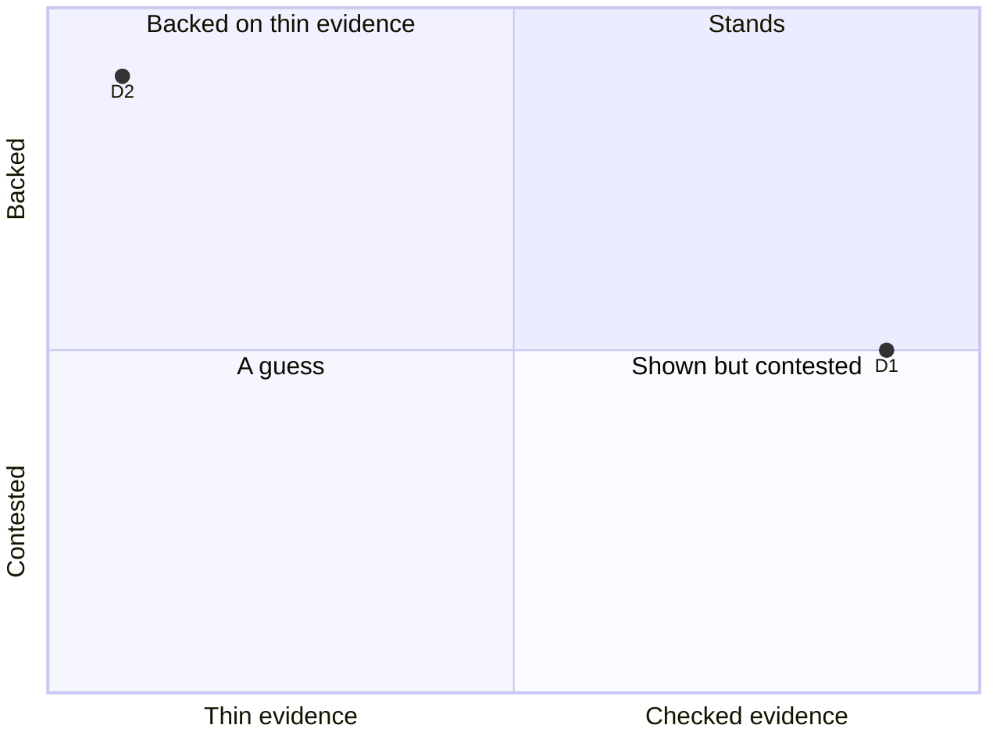

# Council discussion: Thêm tập cá npm vào benchmark

The report: [2026-11-23-them-tap-ca-npm.md](2026-11-23-them-tap-ca-npm.md).

## At a glance

Each direction (D1 is direction 1) by how much of its evidence the cite check found holding (across) and how much of the panel backs it (up).

## Directions

1. **Thêm 20 gói npm có CVE** (Agreed)
   From P1 (Phương pháp).
   Tập npm đổi các con số của chương 3. Sửa chữ trước sẽ phải viết lại.
   First step: Chọn 20 gói trong results/npm/pool.csv.
   Stances: Phản biện challenge.

2. **Sửa chữ chương 3** (Split)
   From P2 (Phản biện).
   Chương 3 còn hai chỗ viết sai tên tập. Nên sửa sau khi có số liệu mới.
   Stances: Phương pháp accept.

## Also raised

- **Bỏ tập PyPI** (from P2 (Phản biện)): Không có CVE nào để đo.

## Ask next

- To Phản biện: Thầy có cần đủ 60 gói không?

## Matrix

| Proposal | Phương pháp | Phản biện | Outcome |
|---|---|---|---|
| P1 · Thêm 20 gói npm có CVE trước | author | challenge: Hai chỗ sai tên tập vẫn phải sửa. | Hướng 1 |
| P2 · Sửa chữ chương 3 trước | accept: Sửa sau khi có số liệu mới thì đỡ viết lại. | author | Hướng 2 |

## Figures that did not check out

The seats declared these numbers; Go could not confirm them against the files, so the report's Figures table leaves them out.

| Value | Measures | Source | Why |
|---|---|---|---|
| 33% | ca best-of-k phủ | `results/curve.json:900` | line 900 is past the end (60 lines) |

## Files not copied

These files lie outside the project and were not copied into `docs/council/briefs/`, so the council read them where they are.

- `/tmp/scratch/facts.md`: no such file

## The discussion

- **You** sets the goal
  Nên thêm tập cá npm vào benchmark trước hay sửa lại chương 3?
- **Phương pháp** proposes · P1 · Thêm 20 gói npm có CVE trước
  Tập npm đổi các con số của chương 3.
  Evidence: results/m5.json:12
- **Phản biện** proposes · P2 · Sửa chữ chương 3 trước
  Chương 3 còn hai chỗ viết sai tên tập.
- **Phản biện** has doubts · on P1 · Thêm 20 gói npm có CVE trước
  Hai chỗ sai tên tập vẫn phải sửa.
- **Phương pháp** replies · on P2 · Sửa chữ chương 3 trước
  Sửa sau khi có số liệu mới thì đỡ viết lại.

## Run facts

- Mode: Review · một việc đã có, chờ được phán xét
- Experts: Phương pháp (sonnet), Phản biện (sonnet), Điều phối (opus, coordinator)
- Harness: 2026-11-23.1
- Tokens: 0.8M in 9 calls
- Time: 6 min 12 s
- Ended: done
